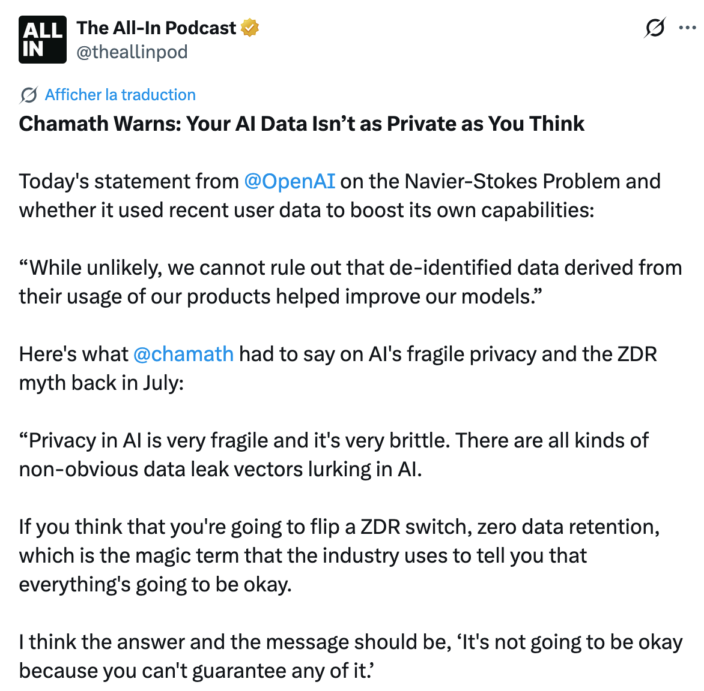
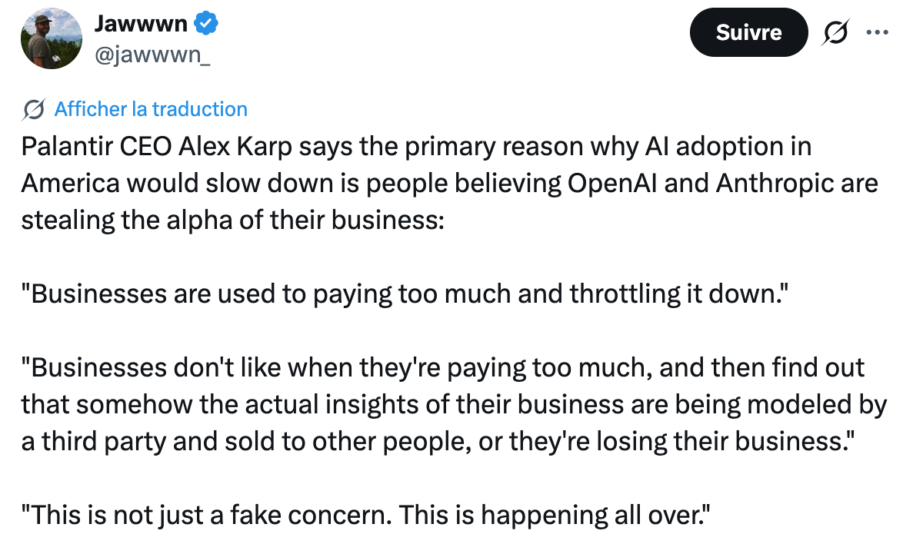
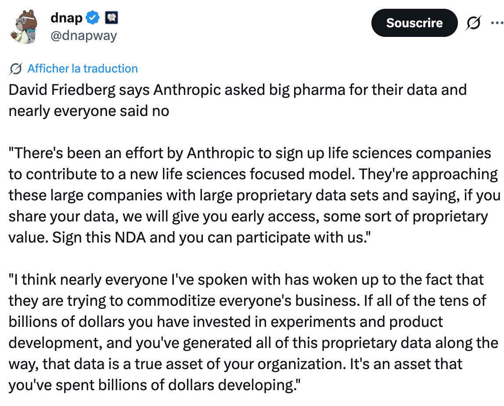
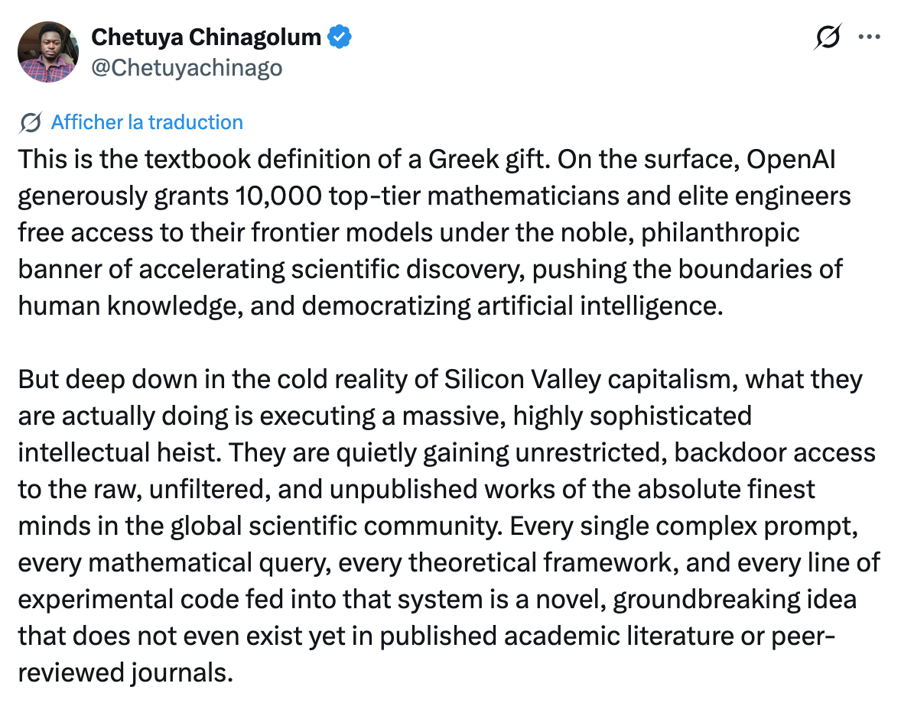
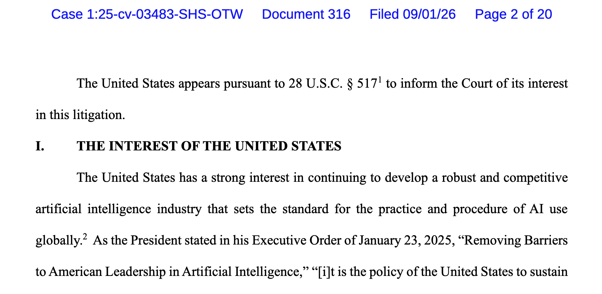
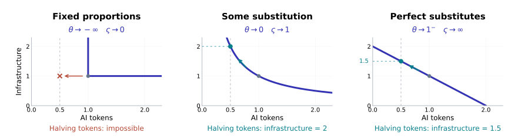
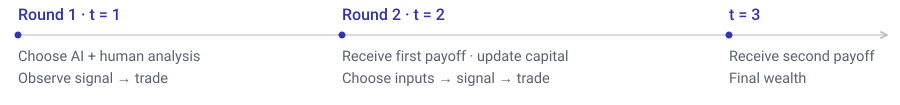
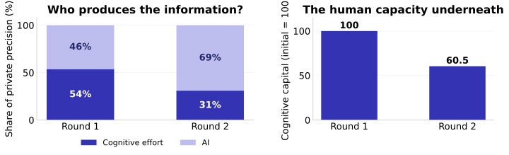

 

# Part I: Who survives AI ?

## Fayçal Drissi

### *University of Oxford*
 

### joint work with Fahad Saleh (University of Florida)

<!--These slides: [https://www.faycaldrissi.com/siam2025](https://www.faycaldrissi.com/siam2025)
[my scholar](https://scholar.google.com/citations?user=njvyriQAAAAJ&hl=fr), 
[my website](https://www.faycaldrissi.com/), [my github](https://github.com/FDR0903)-->

---
section: AI and firms
---

# I. Motivation

{style="transform: translate(60%, 0%); width: 400px"}

---

# I. Motivation

{style="transform: translate(60%, 0%); width: 400px"}

---

# I. Motivation

{style="transform: translate(60%, 0%); width: 400px"}

---

# I. Motivation

{style="transform: translate(60%, 0%); width: 400px"}

---

# I. Motivation
## US DoJ

The US government has sided with OpenAI against the New York Times. The DoJ says training an LLM on copyrighted works does not violate copyright law, and that treating it as infringement would hurt US science, prosperity, and national security.

{style="transform: translate(30%, 20%); width: 500px"}

---

# I. Motivation
## The case of "Wrapper" AI companies

### Startups that do not train their own models

- they are on top of foundation models (GPT, Claude)
- they add prompts, workflows, and integrations to offer a full specialized product
- easiest way for many people to experience generative AI for the first time

 

<v-click>

### Evidence

- **coding**: Windsurf and Cursor replaced by integrated offerings (OpenAI Codex, Anthropic's Claude Code, Google's Jules)

<v-click>

- **design**: Anthropic launched products against their own customers (Figma)

<v-click>

- others: **science, security, law, financial analysis**

<v-click>

 

$\implies$ wrapper firms depend on foundation-model providers for a key input

</v-click>
</v-click>
</v-click>
</v-click>

---

# I. Motivation
##  Models learn from usage

### RLHF: the new standard approach for aligning LLMs with human preferences

- InstructGPT (Ouyang et al., 2022) 
user-submitted prompts from the OpenAI API + human rankings $\to$ reward model $\to$ fine-tuning
- real user behavior and feedback are central to improving the model

 

<v-click>

### Multi-turn RLHF (2024): alignment over entire conversations, not individual turns

- models internalize the scope of discussions, workflows, and their next steps (GPT-5, recent iterations of Claude Code)

 

<v-click>

### Training on usage is now the default

- Anthropic (August 2025): consumer chats and coding sessions train the models
- a continuous learning loop

<v-click>

- July 2026: Claude Cowork: record your screen while you do a task, talk through it as you go, and Claude turns it into a skill it can run again

</v-click>
</v-click>
</v-click>

---

# I. Motivation
##  Shadow AI

- employees using unapproved AI tools: creates major risks of sensitive data leaks
- April 2026: Samsung employees leak internal meeting notes and source code into ChatGPT $\implies$ many companies (JPMorgan, Verizon) block AI chatbots from corporate systems
- New Microsoft research reveals that 71% of UK employees have used unapproved consumer AI tools at work, and 51% continue to do so every week

---

# I. Motivation

### Summary

-  AI models are an input that a growing share of production needs
- providers sell that input, and price it unilaterally
-  **AI models learn from their customers' usage** of the model

<v-click>

 

$\implies$ AI / firms relationship shapes **growth and incentives to create** $\implies$ important to study

<v-click>
 

$\implies$ **this paper**: a model of supplier pricing and learning from customer usage

</v-click>

</v-click>

---

# II. The model

### An AI-based economy: two strategic players, and demand for a product

<v-click>

**1. A firm** 
- the firm sells a product to buyers
- the firm has a **private competitive advantage** in the market
- production uses the provider's AI model **tokens** alongside infrastructure

 

<v-click>

**2. An AI model provider** 
- provider sells tokens to the firm
- it sets the token price and learns from the firm's usage

 

<v-click>

**3. Buyers** 
- buyers purchase the product from the firm
- total product output is $Q=q_F$

</v-click>
</v-click>
</v-click>

---

# II. The model

### The firm

- the firm sells a product using AI tokens and its own infrastructure

<v-click>

- it holds a **private advantage** $x(t) \geq 0$ over the shared AI model (proprietary data, workflows, know-how)

<v-click>

- buyers value the advantage: they buy the product at
  $$
  D\big(q_F(t)\big) + x(t)
  $$

  - $D(\cdot)$ is an inverse demand function
  - $Q(t)=q_F(t)$ is the firm's output
<v-click>

 

- buyers can also perform the task themselves using the shared model $\implies$ the firm's premium depends on what its product adds

</v-click>
</v-click>
</v-click>

---

# II. The model

### The firm's advantage

- the advantage evolves through two forces, creation and absorption:

  $$
  \dot{x}(t) = \underbrace{\iota(t)}_{\text{innovation effort}} \; - \underbrace{\lambda\, \tau_F(t)\, x(t)}_{\text{absorption}}
  $$

  - $\lambda > 0$ is the absorption speed per token 
  - $\tau_F(t) \geq 0$ is the firm's token usage

<v-click>

- **general solution:**

$$
\begin{aligned}
x(t) = \underbrace{x(0)\, e^{-\lambda \int_0^t \tau_F(u)\,du}}_{\text{remaining initial advantage}}+ \underbrace{\int_0^t \iota(s)\, e^{-\lambda \int_s^t \tau_F(u)\,du}\,ds}_{\text{surviving innovations}}
\end{aligned}
$$

$\implies$ without innovation ($\iota=0$), only the first term remains: the advantage decays with **cumulative usage**

</v-click>

---

# II. The model

### The firm's production

- infrastructure $S_F$ evolves through investment and depreciation: $\small \qquad \dot S_F=I_F-\delta S_F$

<v-click>

- production technology: constant elasticity of substitution $\qquad \qquad \small q_F=G(\tau_F,S_F)=\Big[\omega\,\tau_F^{\theta}+(1-\omega)\,S_F^{\theta}\Big]^{1/\theta}$

<v-click>

$\theta\uparrow\ \implies\ \varsigma=\dfrac{1}{1-\theta}\uparrow$: **easier to replace one input with the other at the same output**.

</v-click>
</v-click>

<!--
Figure reproduced by scripts/create-ces-substitution-figure.py.
Every panel fixes output q_F=1 and the CES weight omega=1/2, with identical axis scales.
In the theta -> -infinity limit, G=min(tau_F,S_F); the L-shaped contour requires
both inputs to be at least 1. Extra infrastructure cannot replace missing tokens.
In the theta -> 0 limit, G=sqrt(tau_F*S_F), so halving tokens requires S_F=2.
At theta=1, G=(tau_F+S_F)/2, so halving tokens requires S_F=1.5.
The elasticity formula tends to infinity as theta -> 1 from below; it is not finite
at theta=1. The displayed theta-zero production function is understood by continuity.
Curvature shows the trade-off between input quantities, rather than a literal plot
of elasticity against theta. Higher theta increases the elasticity of substitution.
-->

---

# II. The model

### The firm's problem

<v-click>

- producing has costs
  - tokens cost the price $p$ per unit
  - investment cost $h_F(I_F(t))$: increasing, convex
  - innovation cost $\kappa(\iota(t))$: strictly convex

<v-click>

 

- the firm has instantaneous profit:

$$
\pi_F = \underbrace{\big[ D(Q) + x \big]\, q_F}_{\text{revenue at the premium}} \; - \underbrace{p\, \tau_F}_{\text{token bill}} \; - \underbrace{h_F(I_F)}_{\text{investment}} \; - \underbrace{\kappa(\iota)}_{\text{innovation}}
$$

 

<v-click>

- the firm maximizes

$$
\max_{\tau_F,\; I_F,\; \iota} \;\; \int_0^\infty e^{-r_F\, t}\, \pi_F(t)\, dt
$$

</v-click>

</v-click>

</v-click>

---

# II. The model

### The AI model provider

- the AI provider sells tokens to the firm
  - it posts the token price $p(t)$ continuously
  - it bears a token serving cost $\Gamma(\cdot)$: increasing, convex

<v-click>
 

- the AI provider has instantaneous profit:

$$
\small
\pi_P = \underbrace{p\, \tau_F}_{\text{token revenue}} \; - \; \underbrace{\Gamma(\tau_F)}_{\text{token serving cost}}
$$

<v-click>
 

- the AI provider maximizes

$$
\max_{p} \;\; \int_0^\infty e^{-r_P\, t}\, \pi_P(t)\, dt
$$

</v-click>
</v-click>

---

# III. Results

## Model solution: very hard in the general case

<v-click>

 

### The linear case

- linear inverse demand 
$$D(Q) = a - b\, Q$$
- linear investment cost

$$h_F(I) = \chi_F\, I$$

- quadratic innovation cost 
$$\kappa(\iota) = \kappa_0\, \iota + \dfrac{\kappa_1}{2}\, \iota^2$$ 

- linear token serving cost 
$$\Gamma(\tau) = \gamma_s\, \tau$$

</v-click>

---

# III. Results

##  The equilibrium system in the linear case

- equilibrium $\equiv$ system of coupled ODEs with free boundaries

$$\footnotesize
r_F V_F = \frac{\big( a + x - c_F(\tilde{p}) \big)^2}{4b} + \frac{\big( \max\{0,\; \partial_x V_F - \kappa_0\} \big)^2}{2 \kappa_1}
\qquad\text{and}\qquad
r_P V_P = \iota\, \partial_x V_P + \max_{p \, \geq\, 0}\; \tau_F(x, p) \Big( p - \gamma_s - \lambda\, x\, \partial_x V_P \Big)
$$

 

<small>
<small>

- $\tau_F$: firm's token demand
- $\iota$: innovation
- $\tilde c=c_F(\tilde p)$: firm's effective unit production cost, with $\tilde p=p+\lambda x\,\partial_xV_F$ (token price plus the shadow cost of absorption)
- $c_P$: provider's unit cost (tokens at $\gamma_s$, stock at $\zeta_P$)
- $\varsigma = 1/(1-\theta)$: elasticity of substitution.

</small>
</small>

---

# III. Results

##  Result 1: firms restrict their use of the model

<v-click>

- the firm's marginal revenue from tokens stays **strictly above** the token price:

$$\small
\underbrace{\frac{\partial}{\partial \tau_F} \Big[ \big( D(Q) + x \big)\, q_F \Big]}_{\text{marginal revenue from each token}} - \;\, \underbrace{p}_\text{token price}
\;\; = \; \underbrace{\lambda\, x\, \partial_x V_F}_{\text{destroyed exclusivity}} \;\; > \;\, 0
$$

 $q_F = G(\tau_F, S_F)$ is output 

- marginal revenue from tokens falls with use $\implies$ firm using tokens optimally would buy them until marginal revenue $=$ token price

- **positive** difference $\implies$ the firm gives up tokens today because it adjusts token prices to account for destroyed exclusivity  
<v-click>

$\implies$ restraint is **equilibrium self-defense**

$\implies$ adoption of AI can be low where AI is productive 

$\implies$ should we regulate how AI learns ?

</v-click>
</v-click>

---

# III. Results

## Result 2: the price of tokens

#### Token price balances two motives for the AI model provider

$$\small
\underbrace{\frac{\partial}{\partial p} \Big[ \big( p - \gamma_s \big)\, \tau_F(x, p) \Big]}_{\text{marginal instantaneous profit from tokens}}
\;\; = \;\;
\underbrace{\lambda\, x\, \big(\partial_p \tau_F\big)\, \partial_x V_P^0}_{\text{learning motive}}
$$

<v-click>

- a provider extracting everything from token revenue sets token price where marginal profit $= 0$

- the provider prices **off** that optimum on purpose: token profit against model learning

<v-click>

- the sign of the learning motive is the provider's **posture** toward its customer
  - if positive: the provider prices **below** the price, possibly **below cost**, to accelerate absorption
  - if negative: the provider prices **above** the price to maximize revenue

</v-click>
</v-click>

---

# III. Results

##  Result 3: who survives AI?

Depends on the production technology !

<v-click>

- Case 1: stock and AI are **substitutes** ($\theta > 0$)
  - the firm can shift production onto its non-AI capacity
  - **equilibrium = perpetual innovation**

<v-click>
 

- Case 2: stock and AI are **complements** ($\theta \leq 0$)
  - the firm cannot produce without tokens
  - equilibrium depends on AI retraining rate: 
    - **equilibrium = decreased innovation** if competitve edge disappears too fast

<v-click>

 

$\implies$ which regime a firm faces is a property of its **production technology**

$\implies$ most exposed: the firms that **must** use the model to operate

</v-click>
</v-click>
</v-click>

---
section: AI and learning
layout: center
class: text-center
---

<h1 style="font-size: 3.7rem; line-height: 1.2;">Financial markets and AI</h1>

 

### joint work with Andrea Barbon

<!--
Transition from the first paper: firms' use of AI changes the value of their knowledge.
The second question concerns the people producing and interpreting that knowledge.
Motivation follows the Collective intelligence paragraph of application_outline.tex,
with the empirical claims checked against the original sources.
-->

---

# I. Motivation

## AI changes the work involved in cognitive tasks

- people delegate parts parts of the cognitive work
- this usually improves performance in interpreting information, exercising judgment, developing ideas

<v-click>

 

### Cognitive tasks with AI decreases practice

- reasoning through a problem helps develop the ability to solve the next one
- congitive tasks build expertise

</v-click>

Bengio et al. (2026), International AI Safety Report 2026, §2.3.2.

<!--
The report synthesizes emerging evidence about cognitive offloading and human autonomy.
It also describes benefits and emphasizes that long-term evidence remains limited.
The practice mechanism motivates the model; this slide does not claim that all AI use erodes skills.
-->

---

# I. Motivation

## Evidence: AI-assisted writing

### Kosmyna et al. (2025), *Your Brain on ChatGPT*

- **54 participants** wrote essays with ChatGPT, search engines, or no tools
- EEG measurements and interviews to track engagement, recall, and ownership

<v-click>

 

### What the study reports

- the ChatGPT group showed **weaker EEG connectivity during writing**
- participants had more difficulty quoting their own essays

</v-click>

Kosmyna et al. (2025), Your Brain on ChatGPT: Accumulation of Cognitive Debt when Using an AI Assistant for Essay Writing Task. 
Small, task-specific study; long-run effects on skills remain an open question.

<!--
54 participants completed sessions 1–3; 18 returned for a crossover session.
Connectivity measures task-time functional activity, not structural brain damage.
Avoid claiming a percentage fall in total brain activity or permanent loss of intelligence.
The authors emphasize the study's task-specific scope and the limits of its interpretation.
-->

---

# I. Motivation

## Evidence: solving mathematics with AI

### Bastani et al. (2025): a randomized field experiment

Nearly 1,000 high-school students; AI-assisted practice followed by an **unaided exam**.

| Access during practice | Practice scores | Subsequent unaided exam |
| --- | --- | --- |
| Standard GPT-4 chat | **+48%** | **−17%** |
| Tutor with teacher-designed hints | **+127%** | No significant difference |

<v-click>

 

$\implies$ better performance can coexist with less learning

$\implies$ how the tool is designed and used matters

</v-click>

Bastani et al. (2025), Generative AI without guardrails can harm learning: Evidence from high school mathematics. 
Changes relative to the group without AI; percentages, not percentage points.

<!--
Supplementary primary evidence, added because it directly speaks to a maths audience.
Study took place in a Turkish high school over four sessions, using GPT-4.
The tutor's unaided exam result is statistically indistinguishable from the control group;
it is not evidence of improved exam learning. These are short-term outcomes in this setting.
The published correction concerns an author's affiliation.
-->

---

# II. The model

## The financial market

### Two trading rounds, and a continuum of risk-averse traders

- traders $i\in[0,1]$ buy and sell a risky asset at each date $t=1,2$
- asset pays a payoff $v_t$ at each date $t=1,2$

$$
v_t\sim N(0,\tau_v^{-1})
$$

- traders observe private information about the payoff, and the market price $p_t$

 
 

<!--
Zero net supply, a riskless asset with zero return, and common CARA risk aversion gamma.
Round-1 asset pays at t=2; round-2 asset pays at t=3. Independent payoffs isolate skill dynamics
from persistent information about the same asset. Gaussian noise here concerns information,
not Brownian uncertainty in the first paper's advantage dynamics.
-->

---

# II. The model

### Each trader sets the precision of a private signal

$$
s_{i,t}=v_t+\varepsilon_{i,t},\qquad
\varepsilon_{i,t}\sim N(0,x_{i,t}^{-1}),\qquad
x_{i,t}=\underbrace{a_{i,t}}_{\text{AI}}+\underbrace{h_{i,t}}_{\text{cognitive effort}}
$$

- a higher precision $x_{i,t}$ means a less noisy signal

<v-click>

 

- Cognitive effort and AI use are costly

$$
C_A(a_{i,t})=c\,a_{i,t},\qquad C_H(h_{i,t},k_{i,t})=\frac{h_{i,t}^2}{2k_{i,t}}
$$

- $c>0$: the price of AI-produced precision
- $k_{i,t}>0$: cognitive capital of trader $i$:  more expertise makes cognitive effort cheaper

</v-click>

<!--
Human processing h is measured in units of signal precision, not literal hours worked.
All signal errors are independent across traders and dates in the baseline.
Notation follows ANDREA: c is the AI price, p is the asset price, a is AI precision,
and u is noise-trader demand. This avoids the grant's alternative notation.
-->

---

# II. The model

### Cognitive capital dynamics

$$
k_{i,2}=\underbrace{(1-\delta)\ k_{i,1}}_{\text{depreciation}}
+\underbrace{\lambda\ h_{i,1}}_{\text{learning by doing}},
\qquad \delta\in(0,1),\quad \lambda>0
$$

- cognitive effort: interpret information today + build expertise for tomorrow

<v-click>

 

 

$\implies$ AI affects cognitive capital through the **choice to delegate** and reduced practice

$\implies$ traders anticipate the effect of their choices on future expertise

</v-click>

<!--
AI does not enter the capital law directly. Substitution changes optimal h, which changes k.
This is the paper's central modelling step: skill erosion is an equilibrium consequence
of the information-production choice, rather than a direct damage term imposed on AI use.
-->

---

# II. The model

### The trader's objective

$$
\begin{gathered}
\max_{\{a_{i,t},h_{i,t},q_{i,t}\}_{t=1}^{2}}\; \mathbb{E}\!\left[-e^{-\gamma W_{i,3}}\right]
\qquad\text{where}\qquad
W_{i,3}=W_0+\sum_{t=1}^{2}\Bigg[
\underbrace{q_{i,t}(v_t-p_t)}_{\text{trading profit}}
-\underbrace{ca_{i,t}}_{\text{AI cost}}
-\underbrace{\frac{h_{i,t}^2}{2k_{i,t}}}_{\text{cognitive effort cost}}
\Bigg]
\end{gathered}
$$

- $q_{i,t}$: the position in the risky asset; $\gamma>0$: risk aversion
- traders pay for information before seeing the signal and price

  

<!--
Expected utility is part of the Gaussian financial-information model, as in ANDREA.
This is distinct from the Brownian term removed from the first paper's dynamics.
CARA preferences remove wealth effects; the two rounds are linked through capital alone.

### The trade-off
- Acquire information, trade, and maximize utility from final wealth
- better information improves the trading decision
- human analysis is costly, and preserves future expertise
- AI can make today's information cheaper

-->

---

# II. The model

## Prices aggregate traders' information

- $u_t\sim N(0,\tau_u^{-1})$: random noise-trader demand

$$\text{clearing} \quad \implies \quad
\underbrace{\bar x_t=\int_0^1x_{i,t}\,di}_\text{average precision},\qquad
\widehat p_t=v_t+\frac{\gamma}{\bar x_t}u_t
$$

$\implies$ the price is a public, noisy estimate of the payoff (due to noise trading)

$\implies$ more precise private signals $\overline x_t$ make the market price more informative

<!--
ANDREA Lemma 1: p_t = (xbar_t + tau_p,t)/(tau_v + tau_p,t + xbar_t) times p-hat_t.
The scaling is positive, so the rescaled statistic and actual price carry the same information.
Independent private errors average out; noise-trader demand keeps prices partially revealing.
-->
 

---

# II. The model

## Solved by backward induction

- Date $2$

$$\small
V_2(k)=\max_{a,h\geq0}\left\{B_2(a+h)-ca-\frac{h^2}{2k}\right\}, \qquad B_t(x)=\frac{1}{2\gamma}\ln(\tau_v+\tau_{p,t}+x)
$$

<v-click>

- Date $1$

$$\small
\max_{a_1,h_1\geq0}\left\{B_1(a_1+h_1)-ca_1-\frac{h_1^2}{2k_1}
+V_2\!\left((1-\delta)k_1+\lambda h_1\right)\right\}, \qquad B_t(x)=\frac{1}{2\gamma}\ln(\tau_v+\tau_{p,t}+x)
$$

</v-click>

<!--
B is the choice-relevant certainty-equivalent benefit, not expected trading profit.
Gaussian updating and CARA utility give the log expression exactly.
The objectives are concave. First-order conditions and market clearing then give closed forms.
-->

 

---

# III. Results

## Result 1: traders value expertise

### Optimal cognitive effort includes return to future expertise

$$
h_2=ck_2,\qquad
h_1=\underbrace{ck_1}_{\text{current information}}
+\underbrace{\frac{\lambda c^2 k_1}{2}}_{\text{practice premium}}
$$

- in the last round, marginal cost of cognitive effort equals the cost $c$
- in the first round, traders do extra analysis because it builds cognitive capital / expertise

<!--
These policies and the envelope formula hold where AI is used.
V2' is evaluated holding the second-round price coefficients fixed, as an atomistic trader does.
The practice premium shows that erosion does not require myopic traders.
-->

---

# III. Results

## Result 2: cheap AI can erode cognitive capital

### Optimal dynamics of expertise (cognitive capital)

$$
k_2=\rho(c)k_1,\qquad
\rho(c)=1-\delta+\lambda c\left(1+\frac{\lambda c}{2}\right)
$$

<v-click>

 

- Threshold in token price
  $$
  c<\widehat c:=\frac{\sqrt{1+2\delta}-1}{\lambda}\quad\Longleftrightarrow\quad k_2<k_1
  $$

  - below the threshold, practice does not replace depreciating skills
  - traders understand the future consequence, yet find the cheaper information worthwhile

 

$\implies$ cognitive decline can be **privately optimal**

</v-click>

<!--
ANDREA Proposition on the erosion threshold, within the positive-AI-use region.
This establishes decline from round 1 to round 2, not geometric extinction over an infinite horizon.
Private optimality does not establish social optimality or a welfare loss.
-->

---

# III. Results

## Result 3: cognitive decline is concealed

### The amount of information in the market stays constant, but the human contribution decreases

$$\small
\begin{gathered}
\overline x_{1}=\overline x_{2},\\[-0.2em]
c<\widehat{c}\;\implies\; k_2<k_1
\end{gathered}
$$

p]:m-0 [&>p]:leading-tight">

Model illustration: $c=0.1$, $\delta=0.5$, $k_1=8$; $\gamma=\tau_v=\tau_u=\lambda=1$. Positive AI use in both rounds.

<!--
Figure reproduced by scripts/create-cognitive-capital-figure.py, not estimated from data.
Private precision xbar = (sqrt(17)-1)/2 = 1.561553; price precision = 2.438447 in both rounds.
Human precision is 0.84 then 0.484; capital is 8 then 4.84.
Human information shares are 53.79% and 30.99%; AI fills the residual.
This illustrates the two-round result without importing the correlated-error extension.
-->

---

# III. Results

## Result 4: AI risk

### Remove AI unexpectedly before the second trading round

| | Economy $A$ | Economy $B$ | Economy $C$ |
| --- | --- | --- | --- |
| Round 1 | Uses cheap AI | Uses cheap AI | Never has AI |
| Round 2 | AI shock | Continues | Continues |

<v-click>

 

$$
k_2^A = k_2^B <k_2^C,\qquad \overline x_2^A<\overline x_2^C<\overline x_2^B
$$

- AI adoption leaves less cognitive capital available in the case of AI Shock

 

$\implies$ efficient prices hide AI dependence

</v-click>

<!--
ANDREA fragility proposition: same primitives except AI access in round 1;
c below the erosion threshold and in the AI-use region. Outage is unanticipated.
This is a theoretical counterfactual, not an observed market outage.
Human-only equilibrium precision increases with inherited cognitive capital.
-->

---

# III. Results

## A preliminary empirical test

- compare high-AI-use assets (**top 10% or 25%**) with others, **before and after** market events
- new geopolitical events: proxies for AI shocks
  

| Event | Top 10% AI use | Top 25% AI use |
| --- | ---: | ---: |
| Israel–Hamas war | $-0.0096\;(-1.28)$ | $-0.0113\;(-1.56)$ |
| US outbound-investment restrictions | $-0.0265\;(-2.43)$ | $-0.0244\;(-2.32)$ |

 

$\implies$ negative estimates: **high-AI assets' price efficiency falls relative to the control group**

---
layout: end
---

Thank you !

