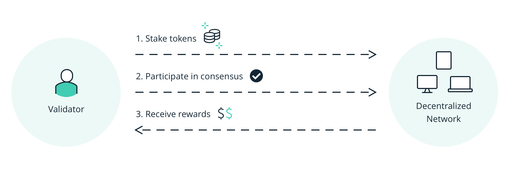
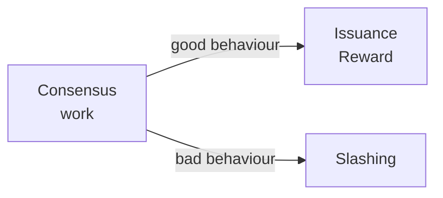
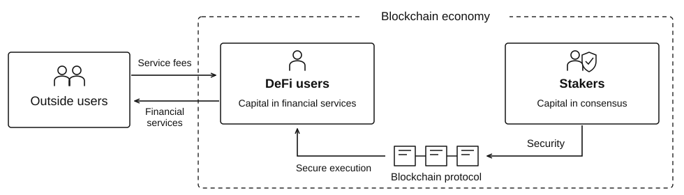
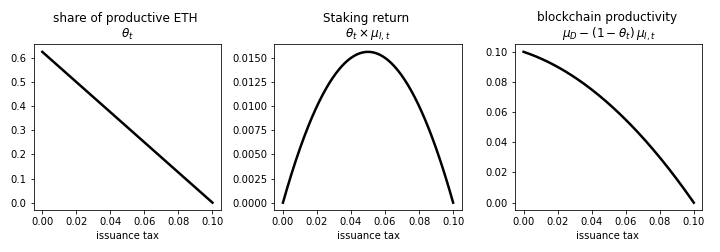
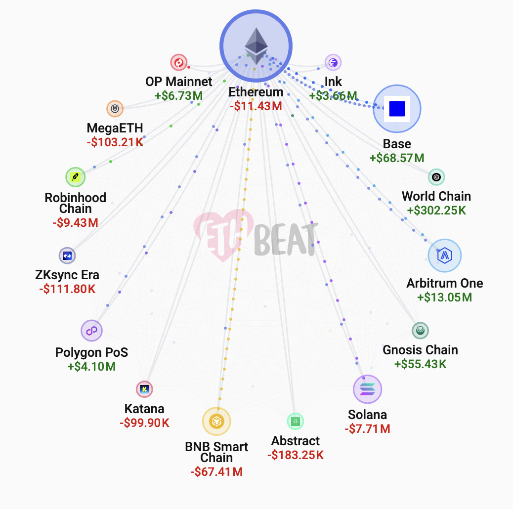
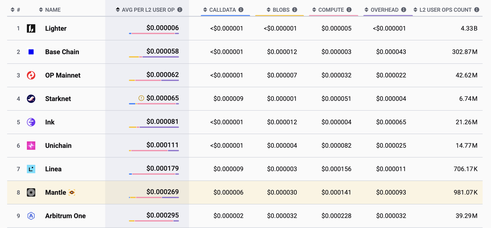
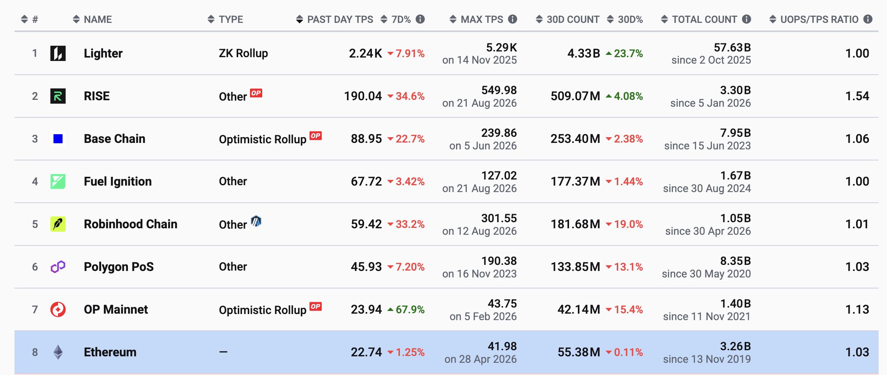
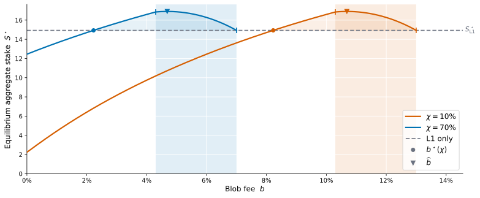

# Economics of proof of stake

## Fayçal Drissi

 

Based on work with

Alvaro Cartea, Nan Chen, Zach Feinstein, Basil Williams, Mingyue Zhong

---
layout: section
section: Issuance tax
class: pos-deck pos-staking
---

# Proof of stake (POS) blockchains

## Staking

- Lock assets on the blockchain to participate in the consensus protocol
- The blockchain pays for security through **issuance**
  - newly created native tokens are distributed to stakers

{style="display: block; margin: 0 auto; width: 850px; max-width: 100%"}

<!-- Source: LST talk 1, slide 3; added Staking heading. -->

---
class: pos-deck pos-security
---

# Proof of stake (POS) blockchains

### Slashing
- The blockchain incentivises correct consensus behaviour through **slashing**

 <v-click>

### Economic security
- A high dollar value of total stake, incentivised by issuance, makes a $51\%$ attack expensive
- Diversity in the staking pool: decentralised staking reduces the risk of coordination attacks

</v-click>

<!-- Source: LST talk 1, slide 4. -->

---
class: pos-deck pos-uses
---

# Two uses of blockchain capital

### DeFi: productive capital

Users lock capital in financial applications. Outside users pay for these services, generating fees and economic value

### Staking: security capital

Stakers lock capital in the protocol. They secure transactions and the financial services built on the blockchain.

{class="uses-diagram"}

<!-- DeFi and staking are two uses of capital: an investor may allocate to both. External demand generates service fees, while staking secures the protocol that supports the financial services. -->

---
class: pos-deck pos-issuance
---

# Issuance / slashing in USD

* Price of ETH $P=\$1$.
* Supply of ETH $Q=2\, \footnotesize\text{ETH}$
* Stakers hold $1$ ETH, DeFi users hold $1$ ETH

$\implies$ market cap of ETH = $Q\times P = \$\,2.$
<v-click>

* Protocol issues $1$ ETH to stakers $\implies$ new supply $Q = 3 \, \footnotesize\text{ETH}$
<v-click>

* Market Cap in USD does not change $\implies$ price adjusts to $P = \$\,2/3$
<v-click>

$\implies$  stakers hold 2 ETH worth $\$\,4/3$,  DeFi users 1 ETH worth $\$\,2/3$

<v-click>

**$\implies$ Issuance redistributes USD wealth from ETH holders to stakers, it does not create or destroy USD**
$$
\boxed{\text{ETH Issuance policy } dI^e_t/I^e_t \equiv \text{USD tax policy } dI^\$_t/I^\$_t \text{ on DeFi users}}
$$

<v-click>

### Slashing
* Slashing burns ETH of stakers and transfers value to non‑stakers via price adjustment

</v-click>
</v-click>
</v-click>
</v-click>
</v-click>

<!-- Source: LST talk 2, slide 9. -->

---
class: pos-deck pos-economy
---

# Blockchain economy and users

* Small open economy with continuum of homogeneous users (mass one).
* Consumption good normalized to $1$ USD.

<v-click>

* Blockchain users choose a consumption stream $\{c_t\}_{t=0}^\infty$ that maximises expected log utility
$$E_0\int_0^{\infty} e^{-\beta\,t}\,\log(c_t)\,dt$$

<v-click>

- Users allocate wealth across:
  1. Consumption (USD)
  2. DeFi  (with native ETH)
  3. Staking

<v-click>

* Each infinitesimal user take as given
  - $P_t$: price of ETH
  - $S_t$: dollar value of staked ETH
  - $D_t$: dollar value of ETH locked in DeFi protocols
  - $Q_t$: supply of ETH in the blockchain

</v-click>
</v-click>
</v-click>

<!-- Source: LST talk 1, slide 9. -->

---
class: pos-deck pos-staking-return
---

# Returns to staking (no slashing)

* Issuance is a proportional rate $dI_t/I_t$, applied to staked ETH, as currently implemented in Ethereum.   The number of ETH issued at time $t$ is
$$
\underbrace{\frac{S_t}{P_t}}_{\text{staked ETH}}
\times
\underbrace{\frac{dI_t}{I_t}}_{\text{issuance policy}}\,
$$
<v-click>

- The dollar value of wealth distributed to stakers at time $t$ is
$$
\underbrace{\frac{S_t}{P_t}\,\frac{dI_t}{I_t}}_{\text{ETH issued}}\times\underbrace{P_t}_{\text{ETH price}}\,
$$
<v-click>

- The return to staking, per dollar locked in staking, is therefore
$$
\frac{d\nu_{S,t}}{\nu_{S,t}} = \underbrace{\frac{S_t}{P_t}\,\frac{dI_t}{I_t}}_{\text{ETH issued}}
\times
\underbrace{P_t}_{\text{ETH price}}
\times
\underbrace{\frac{1}{S_t}}_{\text{normalized by total stake}}
=
\frac{dI_t}{I_t}\,
$$

</v-click>
</v-click>

<!-- Source: LST talk 1, slide 11. -->

---
class: pos-deck
---

# Returns to DeFi

### Returns to DeFi have two components
1. productivity
2. issuance tax

 

<v-click>

### Productivity
* The return from DeFi due to **productivity** is stochastic:
  $$
  \mu_{D}\,dt+\sigma_{D}\,dW_{D,t}\,
  $$
  - $\mu_{D}$: growth of the blockchain economy driven by wealth locked in DeFi protocols and adoption
  - $W_{D,t}$: productivity shocks (exogenous demand shocks, hacks, theft, and political risk)
  - $\sigma_{D}$: scales the magnitude of these shocks

</v-click>

<!-- Source: LST talk 1, slide 12. -->

---
class: pos-deck
---

# Returns to DeFi

### Issuance tax
- Issuance does not create or destroy dollar wealth in the blockchain economy $\implies$ issuance enters as a negative component of returns to productive ETH
$$
- \underbrace{S_t\,\frac{dI_t}{I_t}}_{\text{dollars distributed to stakers}}
\times
\underbrace{\frac{1}{D_t}}_{\scriptsize \begin{array}{c}\text{normalized by dollar}\\\text{value of productive ETH}\end{array}}
$$

<v-click>

### Returns to DeFi
- Combining this issuance tax with stochastic productivity yields the return to DeFi:
$$
\frac{d\nu_{D,t}}{\nu_{D,t}}
= \underbrace{\mu_{D}\,dt+\sigma_{D}\,dW_{D,t}}_{\text{productivity}}
-
\underbrace{\frac{S_t}{D_t}\,\frac{dI_t}{I_t}}_{\text{tax on productive capital}}
$$
</v-click>

<!-- Source: LST talk 1, slide 13. -->

---
class: pos-deck pos-user
---

# Blockchain user problem

- Let $x_t^i$ denote the dollar net worth of user $i\in[0,1]$
- Each user allocates a fraction $\theta_t^i$ of wealth to DeFi, with the remaining share $1-\theta_t^i$ in staking
$$
\frac{dx_t^i}{x_t^i}
=\theta_t^i\,\frac{d\nu_{D,t}}{\nu_{D,t}}
+\left(1-\theta_t^i\right)\frac{d\nu_{S,t}}{\nu_{S,t}}
-\frac{c_t^i}{x_t^i}\,dt,
$$

 

<v-click>

### In the more general model:

#### Dollar return to DeFi: $\small \ \qquad \qquad \qquad \qquad \underbrace{\mu_D\,dt+\sigma_D\,dW_{L,t}}_{\text{productivity rate}}-\underbrace{\frac{S_{t}}{D_t}\frac{dI_{t}}{I_{t}}}_{\text{issuance tax}}+\underbrace{\gamma\frac{S_{t}}{D_t+S_t}dN_{t}}_{\text{deflation}}$

#### $\footnotesize \qquad\qquad\qquad\qquad\qquad\qquad\qquad\qquad\qquad\qquad\qquad\quad\swarrow\qquad\qquad\qquad \nearrow$

#### Dollar return to staking: $\small  \qquad \qquad \qquad \qquad \qquad \qquad  \underbrace{\frac{dI_{t}}{I_{t}}}_{\text{issuance}}-\underbrace{\gamma\frac{D_{t}}{D_t+S_t}dN_{t}}_{\text{slashing}}$

</v-click>

<!-- Source: LST talk 1, slide 14. -->

---
class: pos-deck pos-allocation
---

# Blockchain user problem

- We consider a class of issuance policies that respond to shocks (yielding a unique equilibrium)
$$
\frac{dI_t}{I_t}
=
\frac{D_t}{P_t Q_t}\,\left(\mu_{I,t}\,dt+\sigma_{I,t}\,dW_{D,t}\right)
$$

<v-click>

- Optimal allocation
$$
\theta_{t}^{i\,\star}
=
\frac{\mu_{D}-\mu_{I,t}}{\left(\sigma_{D}-\sigma_{I,t}\right)^{2}}
-
\frac{D_t}{S_t+D_t}\,\frac{\sigma_{I,t}}{\sigma_{D}-\sigma_{I,t}}
$$

$\implies$ Higher issuance reduces the allocation to productive DeFi

<v-click>

- Zero allocation to DeFi if $\qquad \quad\mu_{I,t}\ge \mu_{D}-\frac{D_t}{S_t+D_t}\,\sigma_{I,t}\left(\sigma_{D}-\sigma_{I,t}\right)$

- No staking if  $\qquad \quad\mu_{I,t}\le \mu_{D}-\left(\sigma_{D}-\frac{S_t}{S_t+D_t}\,\sigma_{I,t}\right)\left(\sigma_{D}-\sigma_{I,t}\right)$

</v-click>
</v-click>

<!-- Source: LST talk 1, slide 15. -->

---
class: pos-deck pos-clearing
---

# Clearing

- Aggregate user wealth equals the market capitalization of ETH:
$$
x_t \equiv \int_0^1 x_t^i\,di = P_t Q_t,
$$

- Portfolio choices clear the DeFi and staking markets:
$$
D_t = \theta_t\,x_t
\qquad\text{and}\qquad
S_t = (1-\theta_t)\,x_t
\qquad \implies \qquad
P_t\,Q_t = S_t+D_t
$$

<v-click>

- Only DeFi and consumption creates or destroys wealth

$$
\frac{d(P_t Q_t)}{P_t Q_t}
=
\theta_t^\star\big(\mu_D\,dt+\sigma_D\,dW_{D,t}\big)
-\beta\,dt.
$$

</v-click>

<v-click>

- Staker holdings change due to issuance

$$
dQ_{t}=\frac{S_{t}}{P_{t}}\,\frac{dI_{t}}{I_{t}}
$$

</v-click>

<!-- Sources: LST talk 1, slide 16 (clearing only), slide 17 (market cap), slide 19 (aggregate supply); LST talk 2, slide 11 (wealth and holdings). -->

---
class: pos-deck pos-equilibrium
---

# Equilibrium

### Equilibrium allocation

- All users choose the same portfolio share:
  - $\theta_t^{\star}=0$ if $\mu_{I,t}\ge \mu_D$
  - $\theta_t^{\star}=1$ if $\mu_{I,t}\le \mu_D-\sigma_D\left(\sigma_D-\sigma_{I,t}\right)$
  - Otherwise,
  $$
  \theta_t^{\star}
  =
  \frac{\mu_D-\mu_{I,t}}{\sigma_D\left(\sigma_D-\sigma_{I,t}\right)}
  $$

<v-click>

### Equilibrium staking return

$$
\frac{\mu_D-\mu_{I,t}}{\sigma_D\left(\sigma_D-\sigma_{I,t}\right)}\,\mu_I
$$

</v-click>

<v-click>

### Equilibrium productivity of the blockchain

$$
\mu_D\,\left(1-\frac{\mu_D-\mu_{I,t}}{\sigma_D\left(\sigma_D-\sigma_{I,t}\right)}\right)\,\mu_I
$$

</v-click>

<!-- Sources: LST talk 1, slide 16 (symmetric allocation) and slide 18 (staking return and productivity). Equations reproduced as written in the source. -->

---
class: pos-deck pos-laffer
---

# Laffer curve: dangers of too much issuance

$$
\boxed{\ \text{staking return}\ =\ \text{productive base}\ \times\ \text{issuance tax rate}\ }
$$

{style="display: block; margin: 0 auto; width: 620px; max-height: 220px; object-fit: contain"}

- Higher issuance raises the tax applied to productive output
<v-click>

- It simultaneously reduces the equilibrium amount of productive ETH
<v-click>

- Beyond a certain point, the contraction of the tax base dominates the increase in the tax rate
<v-click>

- **In practice**: with an outside investment option, when staking returns fall below the risk-free rate, users leave the blockchain

</v-click>
</v-click>
</v-click>

<!-- Sources: LST talk 1, slide 18 (plot and explanation); LST talk 2, slide 13 (staking return = productive base × issuance tax rate). -->

---
class: pos-deck pos-policy
---

# Issuance (and slashing) are useful

### Issuance policy is effective because it influences dollar incentives

$$\footnotesize
\text{allocation } = \theta({\color{red} \mu_{\iota}}, {\color{red} \sigma_{\iota}}) \qquad \qquad \qquad \text{ETH prices: } \begin{cases}
\text{drift}  & = \mu_P({\color{red} \mu_{\iota}},{\color{red} \sigma_{\iota}})\\
\\\text{productivity shocks}  & = \sigma_P({\color{red} \mu_{\iota}},{\color{red} \sigma_{\iota}}) \\
\\\text{slashing shocks} & =\gamma_P({\color{red} \mu_{\iota}}, {\color{red} \sigma_{\iota}})
\end{cases}
$$

 

<v-click>

### Slashing is effective because it influences dollar incentives

 

<v-click>

### Policy objectives can be attained

- Reduce eth volatility
- Target staking share
- Long-term economic security (incentivise productivity and then increase security)

</v-click>
</v-click>

<!-- Source: LST talk 1, slide 20. -->

---
class: pos-deck pos-prices
---

# ETH prices

### Equilibrium and clearing conditions

- Assume  $dP_t / P_t = \mu_{P,t} \, dt + \sigma dW_{D,t}$
$$
\begin{aligned}
\mu_{P,t}&=
\underbrace{\theta_t^{\star}\,\mu_D
-\beta}_\text{discounted productivity}
-\underbrace{\left(1-\theta_t^{\star}\right)\,\mu_{I,t}^e}_\text{inflation from issuance}
\\[5pt]
&-\underbrace{\theta_t^{\star}\left(1-\theta_t^{\star}\right)\sigma_{I,t}^e\,\sigma_D}_\text{inflation/deflation: productivity shocks}
+\underbrace{\left(1-\theta_t^{\star}\right)^2\sigma_{I,t}^{e\,2}}_\text{issuance risk}\\
\\
\sigma_{P,t}&=
\underbrace{\theta_t^{\star}\,\sigma_D}_{\text{productivity risk}}
-\underbrace{\left(1-\theta_t^{\star}\right)\,\sigma_{I,t}^e}_{\text{issuance risk}}\,.
\end{aligned}
$$

 $-\theta_t^{\star}\,(1-\theta_t^{\star})\,\sigma_{I,t}^e\,\sigma_D$: issuance that expands ETH supply in response to positive shocks generates an inflationary effect

 $(1-\theta_t^{\star})^2\,\sigma_{I,t}^{e,2}$: higher issuance volatility increases the riskiness of staking $\implies$  users reallocate toward productive ETH

<!-- Source: LST talk 1, slide 19, with the supply dynamics removed and the price equation wrapped across lines. -->

---
section: Layer 2
class: pos-deck l2-slide l2-intro
---

# Layer 2 blockchains

- Layer 1 blockchains (L1s) are slow because of consensus $\implies$ throughput is limited.

- **A layer 2 (L2) is a separate blockchain that extends Ethereum and inherits the security guarantees of Ethereum.**

- The main goal of L2s and scalability is to increase transaction speed (faster finality) and transaction throughput (high transactions per second), without sacrificing decentralization or security.

- Capital can flow between L1 and L2s.

{class="l2-network-image"}

<!-- Layer 2 introduction; wording and illustration supplied by the presenter. -->

---
class: pos-deck l2-slide l2-image-slide
---

# L2s are cheap

{class="l2-cost-image"}

<!-- Supplied L2_3.png; retain the complete screenshot and its original values. -->

---
class: pos-deck l2-slide l2-image-slide l2-productivity
---

# L2s are more productive

{class="l2-throughput-image"}

**L2s pay blob fees to L1 stakers.**

<!-- Supplied L2_2.png. As in the model in the source deck, blob fees represent payments supporting L1 staking. The source distinguishes this modeling treatment from Ethereum's burning of blob base fees. -->

---
class: pos-deck l2-slide l2-capital
---

# Capital taxation and security

<h3>Ethereum (L1)</h3>
<table>
<thead><tr><th>Asset</th><th>Value</th><th>Share</th></tr></thead>
<tbody>
<tr class="l2-native-row"><td>Ether — ETH</td><td>&#36;246.5B</td><td>60.0%</td></tr>
<tr><td>Tether — USDT</td><td>&#36;66.7B</td><td>16.2%</td></tr>
<tr><td>USD Coin — USDC</td><td>&#36;42.1B</td><td>10.2%</td></tr>
<tr><td>Chainlink — LINK</td><td>&#36;7.8B</td><td>1.9%</td></tr>
<tr><td>Sky Dollar — USDS</td><td>&#36;5.3B</td><td>1.3%</td></tr>
</tbody>
</table>

<h3>Arbitrum (L2)</h3>
<table>
<thead><tr><th>Asset</th><th>Value</th><th>Share</th></tr></thead>
<tbody>
<tr class="l2-native-row"><td>ETH &amp; derivatives</td><td>&#36;3.64B</td><td>21.3%</td></tr>
<tr><td>Stablecoins</td><td>&#36;9.03B</td><td>52.9%</td></tr>
<tr><td>BTC &amp; derivatives</td><td>&#36;917.34M</td><td>5.37%</td></tr>
<tr><td>Other</td><td>&#36;3.38B</td><td>19.8%</td></tr>
<tr><td>Public RWAs</td><td>&#36;95.49M</td><td>0.55%</td></tr>
</tbody>
</table>

**Productive, non-staked ETH pays for security!**

One dollar on L1 does not pay the same issuance tax as one dollar on L2.

<!-- Tables transcribed from the presenter's two attached images. Ethereum covers selected token values; Arbitrum reports TVS categories, with its original 16 January 2026 date. -->

---
class: pos-deck l2-slide l2-payment
---

# Security payment

L2 operators pay stakers a fee $b$ per dollar of L2 capital and pass it on to investors.

$$
\def\arraystretch{1.65}
\begin{array}{lcc}
\hline
&\textbf{One dollar on L1}&\textbf{One dollar on L2}\\[4pt]
\hline
\text{Payment per dollar}&\iota&
\underbrace{\chi\iota}_{\text{issuance tax}}+
\underbrace{b}_{\text{blob fee}}\\[18pt]
\hline
\end{array}
$$

- $\iota$: issuance tax per dollar of non-staked L1 capital.
- $\chi\in[0,1]$: native-token demand per dollar on L2.

 

$\implies$ Investment on both layers finances L1 staking rewards.

<!-- Source: L2 talk, frame 6. -->

---
class: pos-deck l2-slide l2-impact
---

# L2 trade-off

### More capital

Higher productivity attracts investors

### Less tax

Each dollar pays less issuance tax

How much must L2s pay to preserve L1-only security?

<!-- Source: L2 talk, frame 7. -->

---
class: pos-deck l2-slide l2-security
---

# Security and productivity

- Security is measured by $S$, the **dollar value staked on L1**.

- Productivity returns per dollar

$$
\begin{aligned}
R_1(S)&=\mu_1-\kappa_1J_1(S),\\[10pt]
R_2(S)&=\mu_2-\kappa_1J_1(S)-\kappa_2J_2.
\end{aligned}
$$

- $J_1(S)\sim\operatorname{Poisson}(p_1(S))$ and $J_2\sim\operatorname{Poisson}(p_2)$ are independent.

- $p_1(S)$ strictly decreases in $S$.

<!-- Source: L2 talk, frame 10; independent Poisson counts and decreasing L1 attack intensity retained. -->

---
class: pos-deck l2-slide l2-timeline
---

# Model

Investors and stakers form two continua of infinitesimal agents.

$t=0$

Policy

Issuance $\iota$ and blob fee $b$ are fixed.

$t=1$

Stake commitment

Stakers commit their stake, which determines security of the blockchain economy.

$t=1$

Entry and allocation

Investors decide whether to enter. Entrants allocate $W_E$ between L1 ($W_{E,1}$) and L2 ($W_{E,2}$).

$t=2$

Realization

Productivity output and attacks are realized

<!-- Source: L2 talk, frame 9; timing diagram redrawn in editable HTML/CSS. -->

---
class: pos-deck l2-slide l2-dense l2-investors
---

# Investors' problem ($t=1$)

- Continuum of investors have mean–variance preferences, initial wealth $W_I$, and risk aversion $\rho_I$. They observe aggregate $S$.

- For portfolio shares on L1 and L2, define the net return

$$
R_P(S)=\omega_{I,1}(R_1-\iota)+\omega_{I,2}(R_2-\chi\iota-b).
$$

- Their optimal risk-adjusted excess return over the risk-free rate $r$ is

$$
\Lambda(S)=
\max_{\substack{\omega_{I,1},\omega_{I,2}\ge0\\\omega_{I,1}+\omega_{I,2}=1}}
\left\{\mathbb E[R_P(S)]-\frac{\rho_I}{2}\operatorname{Var}[R_P(S)]-r\right\}.
$$

<v-click>

- Investor $i\in[0,1]$ has private reservation value $\nu^i$. Enters only if

$$
\Lambda(S)\ge\nu^i,
\qquad \nu^i\sim U[0,\bar\nu],
\qquad \Lambda(S)\le\bar\nu.
$$

Productive capital: $\displaystyle W_E=\frac{\Lambda(S)}{\bar\nu}W_I$.

$\implies$ L2s more productive $=$ more capital

</v-click>

<!-- Source: L2 talk, frame 11. Optimization presented before entry. Lambda is the source maximized mean–variance objective minus r, written directly as a maximized excess return; subtracting r does not change optimal portfolio weights. -->

---
class: pos-deck l2-slide l2-allocation
---

# Investors' problem ($t=1$)

- L2-L1 gap

$$
\Delta=
\underbrace{\mu_2-\mu_1-\kappa_2p_2}_{\Delta^{\mu}:\;\text{expected productivity gap}}
+\underbrace{\iota(1-\chi)-b}_{\Delta^{\iota}:\;\text{payment gap}}.
$$

- Optimal investment of infinitesimal staker in L2

$$
\omega_{I,2}^{\star}=
\begin{cases}
0, & \Delta\le0,\\[7pt]
\dfrac{\Delta}{\rho_I\kappa_2^2p_2}, & 0<\Delta<\rho_I\kappa_2^2p_2,\\[7pt]
1, & \Delta\ge\rho_I\kappa_2^2p_2,
\end{cases}
\qquad
\omega_{I,1}^{\star}=1-\omega_{I,2}^{\star}.
$$

<!-- Source: L2 talk, frame 12. -->

---
class: pos-deck l2-slide l2-dense l2-stakers
---

# Stakers' problem ($t=1$)

- Continuum of stakers with mean–variance preferences
- Initial aggregate wealth $W_S$ and risk aversion $\rho_S$.
- Each infinitesimal staker takes the aggregate stake $S$ as given and the reward rate $\tau$ per dollar staked (funded by issuance and blob fees).

<v-click>

- Staker $j\in[0,1]$ chooses the wealth share $\omega_S^j\ge0$ to stake and solves

$$
\max_{\omega_S^j\ge0}\;
\begin{aligned}
&\mathbb E\!\left[(1-\omega_S^j)(1+r)
+\omega_S^j\big(1+\tau-\kappa_1J_1(S)\big)\right]\\[8pt]
&\quad-\frac{\rho_S}{2}\operatorname{Var}\!\left[(1-\omega_S^j)(1+r)
+\omega_S^j\big(1+\tau-\kappa_1J_1(S)\big)\right].
\end{aligned}
$$

</v-click>

<!-- Source: L2 talk, frame 13; original nonnegativity constraint retained. -->

---
class: pos-deck l2-slide l2-stake
---

# Equilibrium conditions (t=1)

### Staking market clearing

$$\text{Aggregate stake: }S^\star=\int_i \omega_S^i W_S^i di$$

### Security payment clearing

$$
\underbrace{\tau^{\star}S^{\star}}_{\substack{\text{Required staking}\\\text{compensation}}}
=
\underbrace{\iota W_{E,1}^{\star}+(\chi\iota+b)W_{E,2}^{\star}}_{\text{Issuance and blob-fee payments}}.
$$

<v-click>

- Result: there is a unique positive equilibrium stake $S^{\star}$.

</v-click>

<!-- Source: L2 talk, frame 14. -->

---
class: pos-deck l2-slide l2-benchmark
---

# The benchmark: L1-only

- The **L1-only economy** at the same issuance rate $\iota$.
- If blob fees are too high $\implies$ no L2 holdings

$$
b\ge b_{\mathrm{deter}}
:=\Delta^{\mu}+\iota(1-\chi)
\quad\Longrightarrow\quad
\omega_{I,2}^{\star}=0.
$$

<v-click>

### Equilibrium stake

$$S_{\mathrm{L1}}^{\star}(\iota)$$

### Productive capital

$$W_{\mathrm{L1}}^{\star}(\iota)$$

</v-click>

<!-- Source: L2 talk, frame 15; final sentence restates the zero-allocation condition. -->

---
class: pos-deck l2-slide l2-blob-fee
---

# Price of security

The minimum fee that preserves L1-only security satisfies

$$
b^{\star}(\chi)=\max\!\left\{
\underbrace{\iota(1-\chi)}_{\text{avoided issuance tax}}
-\underbrace{\Delta^{\iota,\star}}_{\substack{\text{benefit from}\\\text{a larger tax base}}},\;0\right\}.
$$

| Blob fee | Equilibrium stake | Effect of L2 |
| :-- | :-- | :-- |
| $0\le b<b^{\star}$ | $S^{\star}(b)<S_{\mathrm{L1}}^{\star}$ | L2 drains security |
| $b^{\star}\le b<b_{\mathrm{deter}}$ | $S^{\star}(b)\ge S_{\mathrm{L1}}^{\star}$ | L2 funds security |

<!-- Source: L2 talk, frame 16. -->

---
class: pos-deck l2-slide l2-plot
---

# Maximizing security

- Equilibrium stake has a unique maximum at $\widehat b\in[b^{\star},b_{\mathrm{deter}})$.

{class="l2-security-plot"}

<!-- Source: L2 talk, frame 17. Original fig_security_blob.pdf converted to SVG without changing the plot. -->

---
class: pos-deck l2-slide l2-dense l2-output
---

# Productive capital and expected output

- Productive capital

$$
W_E^\star(S^\star)
$$

- Expected productive output

$$
\begin{aligned}
Y^{\star}(S^\star)={}&\underbrace{\omega_{I,1}^{\star}W_E^{\star}
\left[\mu_1-\kappa_1p_1(S^{\star})\right]}_{\text{expected L1 output}}+\underbrace{\omega_{I,2}^{\star}W_E^{\star}
\left[\mu_2-\kappa_1p_1(S^{\star})-\kappa_2p_2\right]}_{\text{expected L2 output}}.
\end{aligned}
$$

<v-click>

- The blob fees that maximize productive capital and productive output exists and is unique.

$$
\begin{aligned}
b_W^{\star}&=\operatorname*{arg\,max}_{b\ge0}W_E^{\star}(b),
& b_Y^{\star}&=\operatorname*{arg\,max}_{b\ge0}Y^{\star}(b).
\end{aligned}
$$

<v-click>

- Both fees are smaller than the blob fee that maximises security.

$$
b_W^{\star}\le\widehat b,
\qquad b_Y^{\star}\le\widehat b,
$$

</v-click>
</v-click>

<!-- Source: L2 talk, frame 18; expected-output equation wrapped without changing its terms. -->

---
class: pos-deck l2-slide l2-dense l2-policy-ranking
---

# Blob fees versus issuance

- The payment for security per dollar is

$$
\iota\,\omega_{I,1}^{\star}+(\chi\,\iota+b)\omega_{I,2}^{\star}.
$$

- **Blob fees yield higher security than issuance**.

$$
\frac{\partial_b S^{\star}}
{\partial_b\!\left[\iota\omega_{I,1}^{\star}+(\chi\iota+b)\omega_{I,2}^{\star}\right]}
>
\frac{\partial_{\iota}S^{\star}}
{\partial_{\iota}\!\left[\iota\omega_{I,1}^{\star}+(\chi\iota+b)\omega_{I,2}^{\star}\right]}.
$$

- The same holds for equilibrium productive capital onchain

<!-- Source: L2 talk, frame 20; derivative denominators retain equilibrium portfolio reallocation. -->
