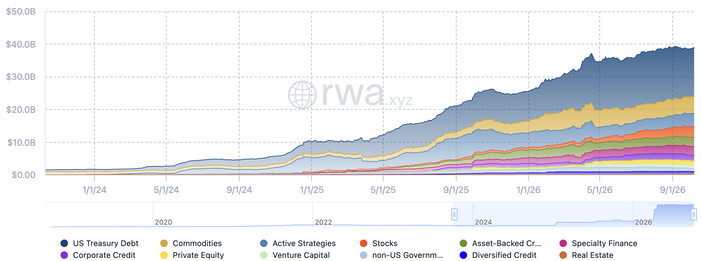
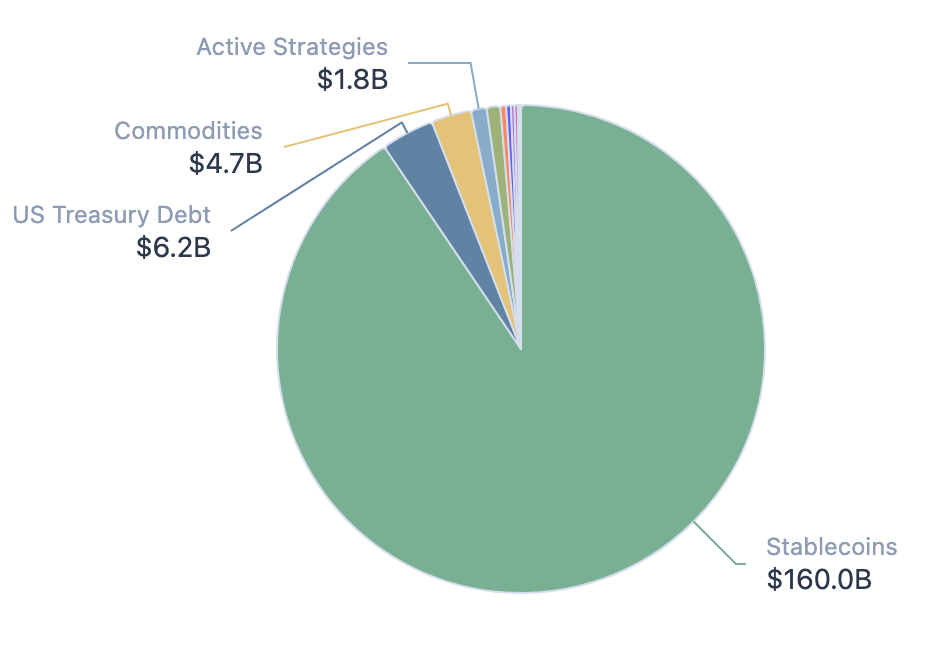
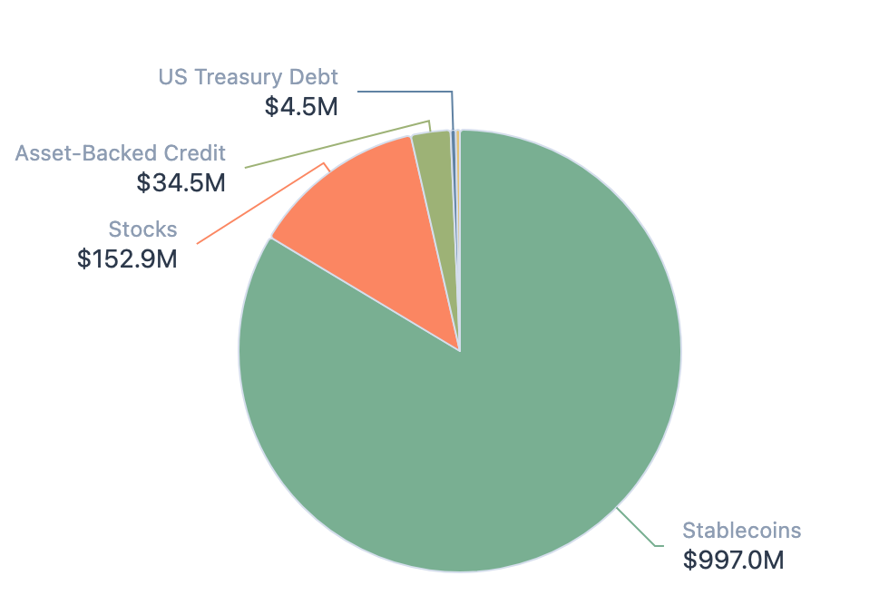
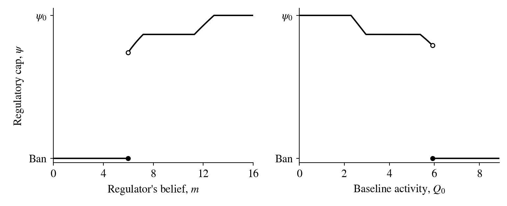
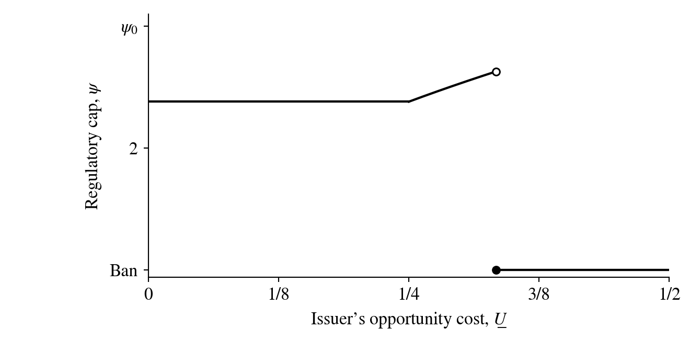
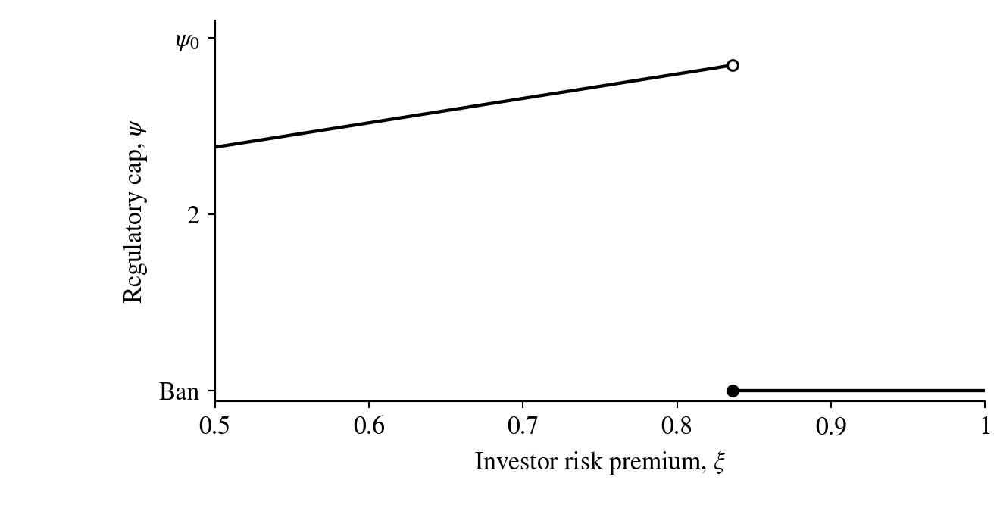
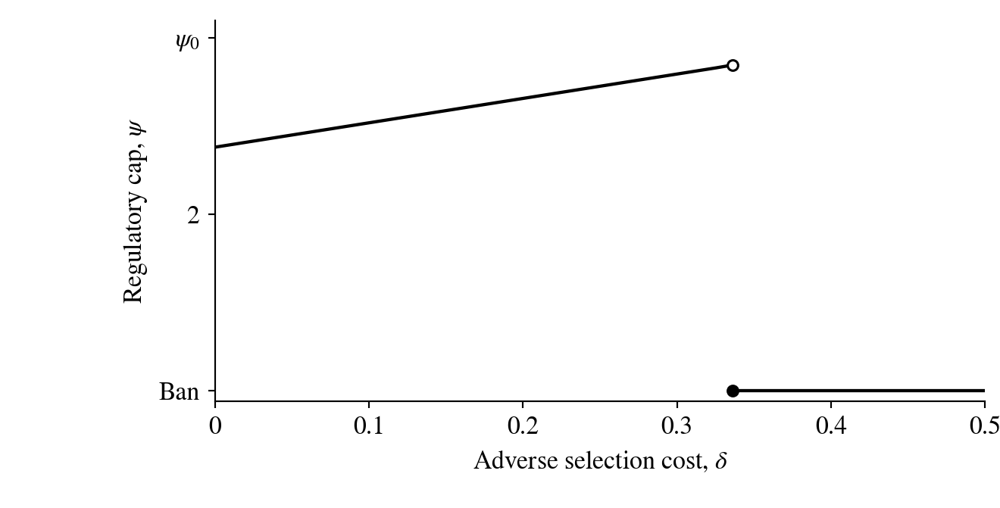
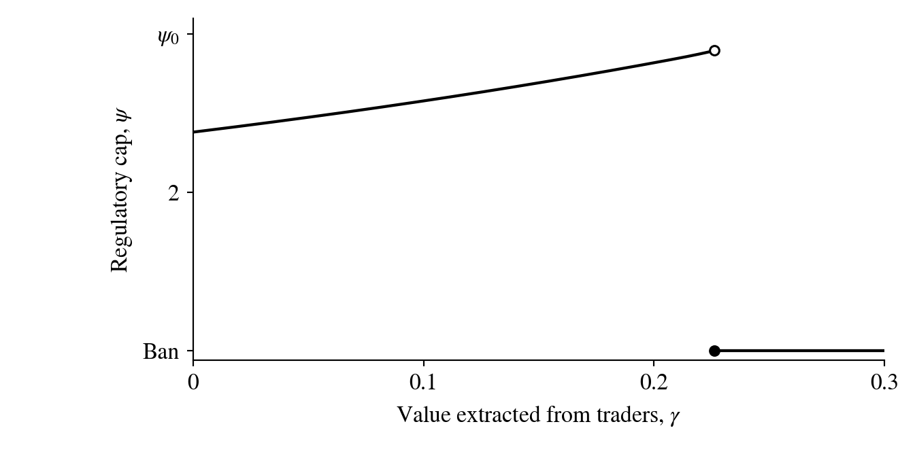
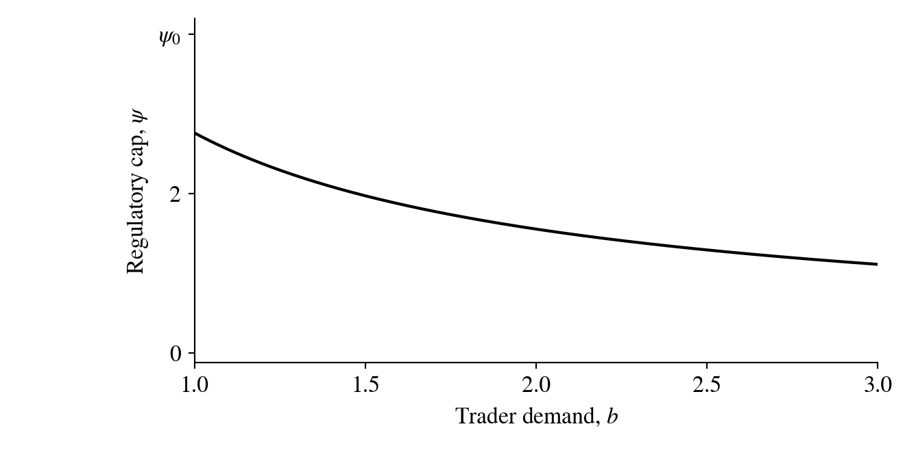

# <small>The Economics of Regulating Tokenized Securities</small>

 

### Álvaro Cartea · Fayçal Drissi · Fahad Saleh

University of Oxford · University of Florida

 

<!--
Time: 0:20. Cumulative: 0:20.
The economic value of tokenization depends on the regulatory environment.
Three parts: the debate and the value proposition → an equilibrium model →
then descriptive evidence on permissioning and differences across assets and platforms.
The talk ends with "Is tokenization viable?".
-->

---
section: Motivation
class: discussion paper-talk growth-slide projection-large projection-extended projection-growth
---

# Tokenization is growing

<!-- Figure size: change --figure-scale below (1 = 100%, 0.8 = 80%, 1.2 = 120%). -->
<figure class="growth-figure" style="--figure-scale: 1;">

<figcaption>Tokenized assets across asset classes · RWA.xyz</figcaption>
</figure>

### Tokenized equities and stocks

$3.7B

### US equity market capitalization

$76.9T

**What makes tokenization economically worthwhile?**

**It depends on the regulatory environment**

<!--
Time: 0:50. Cumulative: 1:10.
Initially show only the plot. Click 1 reveals the market-size comparison to its right.
Click 2 reveals the economic-value question below.
Tokenization has begun and the data are encouraging. The closing slide returns to its scale
relative to conventional equity markets.
The supplied RWA.xyz chart shows growth across a broad tokenized-asset universe,
with Treasury debt its largest displayed component. Labeled dates run January 2024–September 2026.
The chart extends beyond those ticks, and its exact endpoints and snapshot date are not shown.
Let the aggregate growth carry the figure rather than reading every legend category.
Much recent work documents size, activity and adoption. We ask about the economic mechanism
and the regulatory conditions under which tokenization is worthwhile.
-->

---
class: discussion paper-talk projection-large projection-permissioning
---

# Tokenized Securities Are Securities

- Value of tokenization: permissionless

- SEC Chair Paul Atkins (November 2025):

<blockquote class="atkins-quote">

*“**A stock is still a stock** whether it is a paper certificate, an entry in a DTCC account, or represented by a token on a public blockchain.”*

</blockquote>

<blockquote class="atkins-quote atkins-conclusion">

***“Tokenized securities are and will continue to be securities.”***

</blockquote>

 

- **Permissioning undermines liquidity.**

**Daily Turnover**

**Native Assets**

ETH: 6% 
SOL: 8%

**Tokenized Securities**

Whitelist-only: 1.3% 
Accredited-only: 0.02%

<!--
Time: 0:35.
Initially show the permissionless value proposition.
Click 1 reveals the Atkins attribution and both quotations.
Click 2 reveals the permissioning point and the two daily-turnover boxes.
Legal classification follows the instrument's rights and substance, not its recordkeeping technology.
Restrictions depend on the instrument and offering regime. They do not all require accredited investors.
The speech states the Chair's principles. It is not itself a new Commission rule.
The smaller boxes compare daily turnover in native assets and permissioned securities.
Native assets: ETH 6%, SOL 8%. Tokenized securities: whitelist-only 1.3%, accredited-only 0.02%.
Permissioning restricts participation and can undermine liquidity.
-->

---
class: discussion paper-talk projection-large projection-roomy projection-value
---

# Value of tokenization

## DeFi: tokenized assets can earn a passive yield

<v-click at="1">

 

$\implies$ **DeFi can create economic value and help tokenization scale.**

</v-click>

 

Is it enough for the viability of tokenization ? $\implies$ depends on regulation

 

## Regulation is a policy variable

**June 2025 · Atkins:** consider an innovation exemption for onchain products and services. 
**Sept. 2026 · SEC:** conditional Exchange Act relief for DEXs (exchanges) and LPs (dealers).

<!--
Time: 0:40. Cumulative: 5:10.
Click 1 reveals the economic-value point. Click 2 reveals the viability question.
Click 3 reveals the two-line policy timeline.
The useful functionality is programmability. Instead of only holding a tokenized asset,
an investor may supply it to a smart-contract market and receive fees and price-impact revenue.
This incremental return matters relative to holding the underlying asset offchain.
Yield is paid by traders. LPs bear risks and costs. No blockchain is guaranteed to be cheaper.
The paper allows costs to depend on trade size and depth and studies the resulting market's viability.
BIS and the French, Singaporean and Swiss central banks tested AMMs for FX trading and
settlement of hypothetical wholesale CBDCs between simulated financial institutions.
Mariana demonstrates technical feasibility, not measured liquidity gains or live adoption.
Cook discusses automated collateral operations, linked FX transactions and intraday capital use.
The preceding slides establish the constraints. Now introduce our economic value proposition,
then explain that regulators can adjust the compliance environment.
June 2025: Atkins directed staff to consider conditional exemptive relief.
September 17, 2026: the SEC issued conditional Exchange Act relief for permissioned AMMs
trading tokenized NMS stocks and certain proprietary-capital liquidity providers.
The order does not remove securities law or open every tokenized product to everyone.
Order: https://www.sec.gov/files/rules/exorders/2026/34-106402.pdf
This illustrates a changeable legal environment; our illicit-flow cap is an abstraction
of regulatory stringency, not a literal provision of the order.
-->

---
class: discussion paper-talk projection-large projection-roomy
---

# Contribution
 

**An equilibrium model of a tokenized securities market with relevant economic forces**

 

**Two research questions**: 

- How does regulatory stringency affect the viability of tokenization?

- How should regulation be conducted ?

<!--
Time: 0:20. Cumulative: 6:40.
Measuring adoption alone cannot answer these questions.
Our model retains trading-generated returns, endogenous investor capital, and a compliance constraint.
First characterize the effects of stringency on liquidity and commercial viability.
Then let the regulator choose the cap, balancing innovation benefits against illicit-trading harm.
-->

---
class: discussion paper-talk projection-large projection-extended projection-economy
section: Tokenized markets
---

# The economy

<svg class="economy-arrows" viewBox="0 0 864 360" preserveAspectRatio="none" role="img" aria-label="The issuer gives tokens to investors, who deposit them on the blockchain. Traders trade these tokens on the blockchain, generating investor yield. Investors pay an AUM fee to the issuer, the issuer screens traders and bears compliance costs.">
<defs>
<marker id="economy-compliance-head" markerWidth="9" markerHeight="9" refX="8" refY="4.5" orient="auto" markerUnits="userSpaceOnUse"><path d="M0,0 L9,4.5 L0,9 Z" fill="#b7791f" /></marker>
<marker id="economy-revenue-head" markerWidth="9" markerHeight="9" refX="8" refY="4.5" orient="auto" markerUnits="userSpaceOnUse"><path d="M0,0 L9,4.5 L0,9 Z" fill="#475569" /></marker>
</defs>
<g v-click="3">
<path class="kyc-arrow" d="M411,148 L181,242" stroke="#b7791f" marker-end="url(#economy-compliance-head)" />
<path class="compliance-cost-arrow" d="M201,242 L424,148" stroke="#b7791f" marker-end="url(#economy-compliance-head)" />
</g>
<path class="aum-fee-arrow" d="M663,242 L440,148" stroke="#475569" marker-end="url(#economy-revenue-head)" />
<path v-click="2" class="investor-yield-arrow" d="M264,264 L600,264" stroke="#475569" marker-end="url(#economy-revenue-head)" />
<path class="issued-tokens-arrow" d="M536,126 C676,111 770,144 754,242" stroke="#b7791f" marker-end="url(#economy-compliance-head)" />
<g class="economy-token" aria-label="Issued token">
<circle cx="713" cy="148" r="14" fill="#fff4d5" stroke="#b7791f" stroke-width="1.8" />
<circle cx="713" cy="148" r="10" fill="none" stroke="#b7791f" stroke-width="0.8" />
<text x="713" y="148">T</text>
</g>
<path v-click="1" class="deposit-tokens-arrow" d="M704,286 C704,322 595,338 536,338" stroke="#b7791f" marker-end="url(#economy-compliance-head)" />
<path v-click="2" class="trade-tokens-arrow" d="M160,286 C160,322 269,338 328,338" stroke="#b7791f" marker-end="url(#economy-compliance-head)" />
</svg>

**Issuer**

**Traders**

**Investors**

**Blockchain**

KYC/AML

Compliance Costs

AUM Fee

Investor Yield

Tokens

Deposit tokens

Use financial services

<svg class="economy-arrows" viewBox="0 0 864 360" preserveAspectRatio="none" role="img" aria-label="Regulatory policy constrains the issuer.">
<defs>
<marker id="economy-policy-head" markerWidth="9" markerHeight="9" refX="8" refY="4.5" orient="auto" markerUnits="userSpaceOnUse"><path d="M0,0 L9,4.5 L0,9 Z" fill="#b7791f" /></marker>
</defs>
<path class="regulatory-policy-arrow" d="M432,50 L432,104" stroke="#b7791f" marker-end="url(#economy-policy-head)" />
</svg>

**Regulator**

Regulatory Policy

<!--
Time: 0:55. Cumulative: 7:35.
Initially show only the issuer and investors, with the AUM Fee arrow and the gold issuance
arrow, coin and Tokens label between them.
Click 1 reveals the blockchain, the Deposit tokens arrow and its label together.
Click 2 reveals traders, their Use financial services arrow and label, and the Investor Yield
arrow and label. The yield consists of fees and price impact.
Click 3 reveals KYC/AML toward traders and Compliance Costs back toward the issuer,
including both arrows and their labels, together with the regulator and its
downward Regulatory Policy arrow.
The issuer earns fee φ on AUM and bears screening costs.
Traders arrive at rate λ and choose trade size. Investors can instead hold the asset offchain.
Liquidity supply earns incremental revenue. Idle onchain holding does not, while both bear tokenization risk.
All tokenized holdings therefore become liquidity in equilibrium.
The issuer tokenizes only if optimized profit exceeds positive opportunity cost U̲.
First take the cap as given. Later, the regulator anticipates these market responses
and chooses the cap before the issuer's decision.
-->

---
class: discussion paper-talk markdown-slide projection-large projection-overview
---

# Three stage model

   

### Stage 1: issuer

- Issuer decides whether, and how much to issue

 

### Stage 2: investors

- Investors decide how much to invest in DeFi

    

### Stage 3: traders

- Traders consume blockchain financial services

$\implies$ solved by backward induction

---
class: discussion paper-talk markdown-slide model-proposal projection-large projection-model-split projection-traders
---

# Stage 3: traders

- Traders arrive at Poisson rate $\lambda$
- Fraction $\pi$ admitted by issuer
- Observe onchain liquidity $L$

- Traders derive (concave) utility $\Pi(V)$ from trading $V$

- **Cost** to consume onchain liquidity: $\kappa(V/L)$ paid to investors

 

- Traders solve

$$\begin{aligned}
V^\star(L)&=\arg\max_{V\geq0}\\[0.3em]
&\quad\Bigg[\underbrace{\Pi(V)}_{\text{trading utility}}-\underbrace{\kappa\!\left(\frac{V}{L}\right)V}_{\text{costs}}\Bigg]
\end{aligned}$$

<!--
Comparison proposal: replaces the preceding stage 3 slide if selected.
Paper: Model, Traders. Equation trader_problem.
Capital Π denotes utility, whereas π is the acceptance rate.
Concavity is in trading volume V, not in market liquidity L.
κ(V/L) is the cost per unit traded. Total payment to LPs is κ(V/L)V.
This payment includes both trading fees and price impact. γV is value extracted by
profit-seekers, for example through sandwich attacks, and is not LP revenue.
Initially show trader arrivals and their choice given liquidity. Click 1 reveals utility
and its properties. Click 2 reveals trading costs and convexity. Click 3 reveals the
trader's optimization problem. Both legitimate and illicit traders
have the same trading preferences. The admitted arrival rate is λπ.
-->

---
class: discussion paper-talk markdown-slide model-proposal projection-large projection-model-split projection-investors
---

# Stage 2: investors

- Tokenized holdings introduce novel risks (smart-contract, operational, custody)   $\implies$ investors require a **risk premium** $\xi$

<v-clicks at="1">

- Liquidity provision earns a passive **yield**
<!-- Investors can hold the same security off-chain
$\implies$ Idle tokenized holdings earn zero yield but bear risk. $\implies$ **$L^\star=L^\star$**.-->
- **Costs**:
  - adverse selection $\delta$ (asset-specific risk)
  - issuer's management fee $\phi$

</v-clicks>

Return to investment

$$\begin{aligned}
r(L)&=\underbrace{\lambda\,\pi}_\text{trader arrival}\times\text{Yield}(L)
-\delta-\phi
\end{aligned}$$

 

Free entry: investment adjusts until

$$\underbrace{r\!\left(L^\star(\pi)\right)}_{\text{net yield}}=\underbrace{\xi}_{\text{required premium}}$$

<!--
Comparison proposal: replaces the preceding stage 2 slide if selected.
Paper: Model, Investors. Equations lp_return and investor_equilibrium.
The gross incremental yield is trading revenue divided by supplied liquidity L.
Subtract δ and φ to get net incremental return r(L), relative to holding the same
underlying security offchain. Settlement and smart-contract risks motivate ξ.
γ is a trader-side extraction cost and is not another term to subtract from r(L).
Initially show the risks and required premium. Click 1 reveals passive yield,
click 2 the off-chain alternative, and click 3 investor costs. Click 4 reveals
the net-return equation. Click 5 reveals the free-entry condition r(L*) = ξ.
There is no separate investor argmax specified in the paper: capital adjusts until
net return equals the required premium. Click 6 explains why idle onchain holdings
are dominated by supplying liquidity, so AUM and liquidity coincide.
-->

---
class: discussion paper-talk markdown-slide model-proposal projection-large projection-roomy
---

# Stage 1: issuer

<v-clicks at="+0">

- **Regulator** imposes a cap $\psi$ on  **illicit trading**  
$\implies$ regulatory burden
- Issuer decides whether, and how much, to tokenize
- **Revenue**: management fees $\phi\,L^\star(\pi)$ on equilibrium AUM
- Compliance policy: **two ways to comply** 
  - **costless measures**: admit fewer traders $\pi\downarrow$
  - **costly measures**: screen more precisely $\rho\uparrow$ $\implies$ cost $\mathcal C(\rho)$

</v-clicks>

<!--, increasing and convex-->

<!--
Paper: Model, Issuer. Equations feasibility, regulatory, issuer_problem and Ustar.
The issuer chooses acceptance π and precision ρ, not an independent AUM quantity.
Stage 2 gives equilibrium AUM L*(π): investor entry responds to trading revenue.
Stage 3 gives optimal trade size V*(L). This completes backward induction.
φ is fixed. C(1)=0, C'>0, C''>0. At fixed acceptance, precision changes the composition
of admitted traders without changing their total arrival rate λπ or revenue directly.
ρ=qL/qI → qI=π/(μρ+1−μ), qL=ρπ/(μρ+1−μ). Hence admitted illicit flow is
(1−μ)λπ/(μρ+1−μ). The probability restriction qL≤1 gives π≤μ+(1−μ)/ρ.
Initially show the regulator's cap. Click 1 reveals the issuer's choices and the two
ways to comply. Click 2 reveals fee revenue, and click 3 screening costs.
The next slide states the optimization problem and the issuance decision.
-->

---
class: discussion paper-talk markdown-slide issuer-problem-slide projection-large projection-extended projection-issuer
---

# Stage 1: issuer's problem

$$\begin{aligned}
U^\star(\psi)&=\max_{\substack{0<\pi\leq1\\\rho\geq1}}
\quad\left[\underbrace{\phi L^\star(\pi)}_{\text{revenue}}-\underbrace{\mathcal C(\rho)}_{\text{compliance cost}}\right]\\~\\
\text{s.t.}\quad&\text{illicit trading}(\pi, \rho)\leq\underbrace{\psi}_{\text{regulatory cap}}
\end{aligned}$$

  

### Tokenize only if **profit exceeds an opportunity cost** $\underline U>0$:

$$U^\star(\psi)>\underline U.$$

<!--
Paper: Model, Issuer. Equations issuer_problem and Ustar.
The paper defines U* with a supremum. The model solution establishes attainment.
The opportunity cost is positive, underline U>0, and is an outside option rather than
an additional screening cost. Click 1 reveals the issuance decision U*>underline U.
A lower ψ means tighter regulation. We study ψ<(1−μ)λ and assume tokenization is
worthwhile without regulation: underline U<φL*(1). The following result asks how
optimal acceptance and equilibrium liquidity respond as the regulator tightens ψ.
-->

---
class: discussion paper-talk projection-large projection-extended projection-result
---

# Result · Regulation reduces liquidity

**Proposition.** 
Tighter regulation reduces liquidity and trading volumes.

  

<b>ψ ↓ ⇒ π⋆ ↓</b> Lower admitted flow λπ⋆

→

<b>T⋆ ↓</b> Smaller aggregate transfer to liquidity providers

→

<b>L⋆ ↓</b> Liquidity is proportional to the transfer

<!--
Time: 1:05.
Paper: prop:reg_liquidity, supported by prop:flow, prop:transfer and prop:proportionality.
The three channel boxes follow those supporting propositions in order:
lower acceptance and admitted flow, smaller aggregate transfer, then proportional liquidity.
T* denotes the aggregate transfer from traders to liquidity providers, not yield per unit of capital.
This is the issuer's optimal response, not only a mechanical constraint effect.
For ψ<ψ0=(1−μ)λ the cap binds. The issuer uses minimum compliant precision at each π.
The reduced objective has strictly increasing differences in π,ψ on an interval with increasing endpoints.
Optimal acceptance strictly increases with ψ. T*=(ξ+δ+φ)L*.
Issuer policies need not be unique. Monotonicity is in the strong set order.
These comparisons describe the conditional market. When the issuer exits, actual tokenized liquidity is zero.
Net investor yield remains ξ wherever the market exists.
-->

---
class: discussion paper-talk projection-large projection-extended projection-result
---

# Result · Regulation reduces liquidity

 
 

**Proposition.** 
Sufficiently strict regulation makes tokenization non-viable.

<!--

Revenue bounded

→

Screening precision bounded

→

As ψ → 0  
acceptance <b>π⋆ → 0</b>

→

Liquidity L⋆ → 0

-->

 

Profit falls below the  opportunity cost: $\quad U^\star(\psi)<\underline U$

---
class: discussion paper-talk projection-large projection-extended projection-frictions-table
---

# Result · Viability of tokenization is asset-specific / platform-specific

<table class="overshoot-tbl frictions-table">
<thead><tr><th>Asset or platform characteristic</th><th>Economic effect</th></tr></thead>
<tbody>
<tr><td>Higher turnover (overall demand)</td><td>More yield</td></tr>
<tr><td>Greater onchain risk</td><td>Less yield</td></tr>
<tr><td>Greater asset risk (volatility)</td><td>Less yield</td></tr>
<tr><td>Larger illicit share / costlier screening technology</td><td>Compliance more expensive</td></tr>
<tr><td>Greater investor / issuer risks</td><td>Higher ξ and <u>U</u>; less viable tokenization</td></tr>
</tbody>
</table>

 

<!--
Time: 1:05.
The third result concerns asset-specific viability under a common regulatory policy.
Turnover is an empirical indicator of trading demand. Trading generates fees and price-impact revenue for liquidity providers.
Higher ξ,δ,γ or pointwise higher C weakly raises ψ*. Higher legitimate share μ weakly lowers ψ*.
The first family lowers revenue. The second lowers optimized profit through costs or feasibility.
Lower profit requires a looser cap for viability.
Platform features can enter these primitives, but platform choice is not endogenous.
Do not sign the threshold with λ: the formal propositions do not establish that comparative static.
A common cap can keep one asset viable and make another non-viable.
-->

---
class: discussion paper-talk evidence-slide projection-large projection-extended projection-market-evidence
---

# Different outcomes

<figure>
<figcaption>Ethereum</figcaption>

</figure>
<figure>
<figcaption>Robinhood</figcaption>

</figure>

- Stocks not the best fit for tokenization (issuer risk + asset risk)

<!--
Time: 1:00. Ethereum/Robinhood comparison.
Compare the two platform distributions.
Stablecoins dominate. Compare the nonstablecoin mix.
Ethereum: Treasuries $6.2B, commodities $4.7B, strategies $1.8B, stablecoins $160B.
Robinhood: stocks $152.9M, asset-backed credit $34.5M, Treasuries $4.5M,
stablecoins $997M. Unlabeled small slices prevent exact totals.
These are allocations, not identified platform liquidity effects.
The model allows platform risk/execution frictions but does not solve cross-chain sorting.
Composition does not prove the chain caused sorting or rank platform liquidity after controlling for assets.
Connect to ξ,δ (reward needed for capital), γ (trade size), and μ,C (compliance).
These can differ by asset and infrastructure, motivating care with a common policy or exemption.
-->

---
section: Optimal regulation
class: discussion paper-talk markdown-slide optimal-regulation-slide innovation-timing-slide projection-large projection-extended projection-innovation
---

# Model

## Why optimal regulation: **socially beneficial innovation**.

 
<v-click>

## Blockchain activity accelerates innovation

##### inspired by Campello, Cong and Dietrich (2024)

- $Q_0$: existing blockchain activity
- $Q^\star(\psi)$: added activity (tokenized market)
- Total activity: $Q_0+Q^\star(\psi)$

- More activity (legitimate and illicit) accelerates socially useful innovation:

$$\Pr(\tau\leq t)=1-e^{-a[Q_0+Q^\star(\psi)]t}.$$

</v-click>

<!--
Time: 0:45. Section cumulative: 0:45. Optimal-regulation section budget: 5:00.
Attribution: Regulatory uncertainty and fintech innovation, cited in the paper as cong2024regulatory.
Bridge from passive yield and programmable finance to the social benefits of innovation.
Q*(psi) is the dollar trading flow lambda*pi*(psi)*V*(L*(pi*(psi))) in the market above.
Initially introduce existing activity, added tokenized trading, and their units.
Click 1 introduces an exponential innovation time with rate a[Q0+Q*(psi)].
Click 2 emphasizes that more activity shortens the expected waiting time to innovation.
Both legitimate and illicit trading contribute to activity. The innovation channel is
an assumption, not an empirical causal estimate. The next slide values the earlier innovation.
-->

---
class: discussion paper-talk markdown-slide optimal-regulation-slide social-value-slide projection-large projection-extended projection-social-value
---

# Model

##  Social value of tokenization

- $\Theta\geq0$: future social benefit
- $m=\mathbb E[\Theta\mid S]$ : regulator's estimate

- Expected discounted benefit without tokenization:

$$m \ p\left(Q_0\right)=m\, \frac{a\,Q_0}{d+a\,Q_0}.$$

- $d>0$: discount rate.

Tokenization adds incremental social value

$$
mA(\psi)
$$
$$
=m\big[p(Q_0+Q^\star(\psi))-p(Q_0)\big]
$$

- Regulation $\psi$ limits **innovation**

<!--
Time: 0:45. Section cumulative: 1:30.
Continue from the exponential innovation time and activity levels on the preceding slide.
Theta is the future social benefit, potentially including continuing public benefits.
S is information available before the issuer decides to tokenize; m is the conditional mean.
Click 1 introduces discounting. Theta and innovation timing are independent conditional on S.
The expected discounted innovation benefit is m*p(Q0+Q*); without tokenization it is m*p(Q0).
Click 2 displays their difference. A is the incremental discounted value per dollar of m.
Activity changes timing, not the conditional estimate m or the eventual payoff Theta.
This is the added social benefit of tokenization beyond the innovation already supported
by existing crypto and stablecoin trading. The next slide adds the harm from illicit trading.
-->

---
class: discussion paper-talk markdown-slide optimal-regulation-slide social-harm-slide projection-large projection-extended projection-social-harm
---

# Model

## Illicit trading creates social harm

- $h>0$ is the **social harm per dollar of illicit trading**.

$$\text{Total expected harm}=\frac{h\,\psi\,V^\star}{d}$$

- Regulation $\psi$ limits **illicit trading**
- Regulation $\psi$ also limits innovation

<!--
Time: 0:45.
The cap psi limits illicit trade arrivals per unit of time. Multiplying by the
stage-three equilibrium trade size V* gives illicit dollar volume psi*V*.
Initially define social harm per dollar h. Click 1 reveals discounted total harm
h*psi*V*/d and the tradeoff between limiting illicit activity and innovation.
The discount rate d and equilibrium trade size V* are defined on earlier slides.
Constant harm is discounted over the infinite horizon, including after innovation.
When the issuer does not tokenize, trading and illicit harm are zero.
Both legitimate and illicit trading support innovation; illicit activity also
creates the additional social harm.
-->

---
class: discussion paper-talk markdown-slide optimal-regulation-slide regulator-objective-slide projection-large projection-extended projection-regimes
---

# Three regulatory regimes

Regulator anticipates effect of regulatory burden.

<figure class="regulation-regimes-figure">

<figcaption class="regulation-figure-points">

**Higher $m$:** more value from innovation favors looser regulation.

**Higher $Q_0$:** less innovation value favors strict regulation

</figcaption>

</figure>

<v-click>

- SEC  2026 exemption: regulator believes in innovation potential

</v-click>

<!--
Time: 0:35. Section cumulative: 4:00.
Paper Figure 1, original curves and parameters. Left: Q0=32/9; right: m=10.
Left: higher estimates move policy from ban to intermediate regulation to full admission.
Right: existing activity speeds innovation without tokenization, reducing the incremental
benefit of adding this tokenized market. Regulation tightens and eventually tokenization is banned.
The black dot is the ban at the tie; the open dot is the limiting operating policy.
Functional forms: Pi(V)=sqrt(V), kappa(z)=z^2, C(rho)=(rho-1)^2, z=V/L.
Parameters: lambda=8, mu=xi=phi=1/2, delta=gamma=0, a=9/32, d=1,
h=9/16, underline U=v=1/8. Upwards means looser regulation, not more burden.
Ban at zero is a display convention, not an operating tokenized market at psi=0.
-->

---
class: discussion paper-talk optimal-regulation-slide regulation-figure-slide regulation-frictions-slide projection-large projection-extended projection-regulation-grid
---

# Frictions

<figure>
<figcaption>

Issuer's opportunity cost $\underline U$

</figcaption>

</figure>
<figure>
<figcaption>

Onchain risk premium $\xi$

</figcaption>

</figure>
<figure>
<figcaption>

Adverse selection cost $\delta$

</figcaption>

</figure>
<figure>
<figcaption>

Value extracted from traders $\gamma$

</figcaption>

</figure>

- regulator first **loosens regulation** to sustain activity, then **bans tokenization** when social benefits are too small.

<!--
Time: 0:30. Section cumulative: 4:30.
Return to issuer opportunity costs and investor risks/costs from the preceding model.
The fourth panel defines gamma: value extracted from traders by profit-seekers, such as
sandwich attacks. It increases trading costs and lowers trade size; it is not LP revenue.
Read the common pattern: higher frictions reduce activity, so the regulator initially
loosens regulation to sustain innovation, then bans tokenization when net benefits are too low.
These are the four original panels of Figure 2, not a general comparative-statics theorem.
Parameters: lambda=8, mu=phi=xi=1/2, delta=gamma=0, a=9/32, d=h=1,
m=10, Q0=32/9, v=1/8, underline U=1/4, unless varied on an axis.
Functional forms as in Figure 1. For this illustration only, the issuer tokenizes at
profit equal to its opportunity cost, as stated in the paper's caption.
-->

---
class: discussion paper-talk optimal-regulation-slide regulation-figure-slide projection-large projection-extended projection-demand
---

# Stronger demand: stricter regulation

- Stronger demand sustains **innovation benefits** with fewer admitted traders

<!--
Time: 0:30. Section cumulative: 5:00.
Paper Figure 3 varies b in Pi_b(V)=b*sqrt(V), keeping every Figure 2 parameter fixed.
At b=1 the optimal cap is about 2.76; at b=2 it is 1.56; at b=3 it is 1.11.
A lower cap means stricter regulation. Larger trades support liquidity and issuer revenue
even as admission falls; equilibrium screening precision rises along the plotted curve.
All plotted optima strictly satisfy issuer participation, so no equality convention is needed.
The demand multiplier changes the trade sizes of both legitimate and illicit traders.
It does not change arrival intensity lambda or the legitimate share mu.
Call b trader demand, not turnover: at fixed admission, both V and L scale by b^2,
leaving Q/L unchanged. Along the chosen policies admission and turnover actually fall.
Incremental innovation benefits rise along this numerical curve; investor net yield stays at xi.
This supports the stated intuition for the illustration, not a general comparative-statics theorem.
-->

---
layout: end
section: Conclusion
---

Is tokenization viable?

complex equation

<!--
Time: 0:20.
Return to the opening question. Click 1 reveals the market-size benchmarks.
The answer depends on the regulatory environment and the asset's economic characteristics.
Allium reports $2.3B of equities/stocks within $29.5B of tokenized RWAs on 15 July 2026.
SIFMA reports $76.9T in US-listed equities at the end of Q2 2026.
These are scale benchmarks, not a like-for-like share: the token numerator includes global
products and private/pre-IPO exposures. The denominator covers US-listed companies.
Do not describe their ratio as the fraction of US equities tokenized.
Pause for questions.
-->
