

**The Economics of Regulating** **Tokenized Securities**

**Álvaro Cartea1, Fayçal Drissi1, Fahad Saleh2**

1University of Oxford &nbsp;&nbsp; 2University of Florida

<!-- Source: files/seminar.pdf; numbered slide 1/25. Text and mathematics remain editable. -->

---
layout: seminar
title: "Equity Tokenization Remains Trivial in Scale"
---

# Equity Tokenization Remains Trivial in Scale

<figure style="position:absolute;top:65px;left:50px;width:880px;margin:0;">
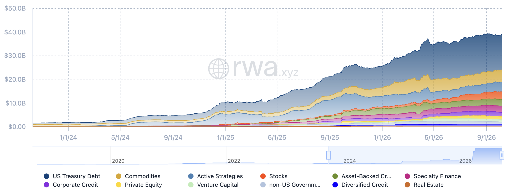
<figcaption style="margin-top:6px;font-size:14px;line-height:1.2;text-align:center;">Tokenized assets across asset classes · RWA.xyz</figcaption>
</figure>

**Tokenized Stocks**

&#36;3.7 billion

**U.S. Equity Market**

&#36;78.7 trillion

<!-- Source: files/seminar.pdf; numbered slide 2/25. Text and mathematics remain editable. -->
<!-- Growth chart added from slides_old.md, "Tokenization is growing". -->

---
layout: seminar
title: "Why Hold Securities Onchain?"
---

# Why Hold Securities Onchain?

Investors can hold the same securities offchain.

Holding onchain introduces novel risks and costs.

An incremental onchain incentive is necessary for tokenization to be viable.

Equilibrium Condition:

**Incremental Onchain Incentive = Incremental Onchain Costs and Priced Risks**

<!-- Source: files/seminar.pdf; numbered slide 3/25. Text and mathematics remain editable. -->

---
layout: seminar
title: "Incremental Onchain Incentive"
---

# Incremental Onchain Incentive

Yield farming can provide the incremental onchain incentive.

Yield farming: supplying tokens as liquidity to earn fees from traders.

Yield farming returns arise via an endogenous externality between trading and liquidity provision.

Regulatory environment endogenously affects yields.

<!-- Source: files/seminar.pdf; numbered slide 4/25. Text and mathematics remain editable. -->

---
layout: seminar
title: "The Role of Regulation"
---

# The Role of Regulation

Tighter regulation reduces trading activity, lowering trading revenues.

Lower revenues reduce incentives for liquidity provision, raising trading costs.

Low trading and low liquidity sustain each other in a low-adoption equilibrium.

A low-adoption equilibrium implies low incentives to tokenize.

<!-- Source: files/seminar.pdf; numbered slide 5/25. Text and mathematics remain editable. -->

---
layout: seminar
title: "SEC Innovation Exemption"
---

# SEC Innovation Exemption

SEC, Release No. 34-106402 (September 17, 2026):

*“Tier 1 Tokenized NMS Stock traded on a TSV . . . cannot exceed . . .*

*0.25 percent of the average daily share volume during the prior month . . . ”*

<!-- Source: files/seminar.pdf; numbered slide 6/25. Text and mathematics remain editable. -->

---
layout: seminar
title: "Main Result"
---

# Main Result

Sufficiently stringent regulation renders tokenization non-viable.

Tighter regulation

$\implies$

Less trading

$\implies$

Lower fee income

$\implies$

Lower onchain investment

$\implies$

Unprofitable issuance

<!-- Source: files/seminar.pdf; numbered slide 7/25. Text and mathematics remain editable. -->

---
layout: seminar
title: "BlackRock USD Institutional Digital Liquidity Fund (BUIDL)"
clicks: 1
---

**BlackRock USD Institutional Digital Liquidity Fund (BUIDL)**

• Tokenized money market fund with underlying assets at BNY Mellon

• Ownership registered onchain by a SEC-registered transfer agent

• Every transfer gated by a compliance check at the token contract level

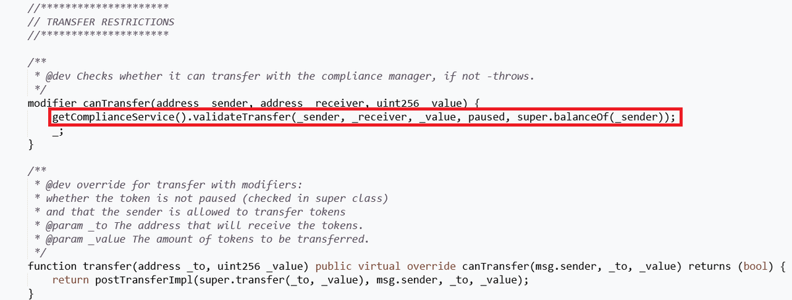

<!-- Source: files/seminar.pdf; numbered slide 8/25. Text and mathematics remain editable. -->

---
layout: seminar
title: "Transfer compliance"
clicks: 3
---

The canTransfer modifier enforces:

<svg class="sem-svg" viewBox="0 0 980 551.25" aria-hidden="true">
<defs>
<marker id="transfer-arrow" viewBox="0 0 8 6" refX="8" refY="3" markerWidth="8" markerHeight="6" orient="auto-start-reverse"><path d="M0,0 L8,3 L0,6" fill="#64748b" /></marker>
<marker id="transfer-pass" viewBox="0 0 8 6" refX="8" refY="3" markerWidth="8" markerHeight="6" orient="auto"><path d="M0,0 L8,3 L0,6" fill="#15803d" /></marker>
<marker id="transfer-fail" viewBox="0 0 8 6" refX="8" refY="3" markerWidth="8" markerHeight="6" orient="auto"><path d="M0,0 L8,3 L0,6" fill="#b91c1c" /></marker>
</defs>
<path v-click="1" d="M490 154.79 V209.91" stroke="#64748b" stroke-width=".86" marker-end="url(#transfer-arrow)" />
<path v-click="2" d="M490 265.04 V320.17" stroke="#64748b" stroke-width=".86" marker-end="url(#transfer-arrow)" />
<g v-click="3"><path d="M427.79 375.72 L315.27 426.34" stroke="#15803d" stroke-width=".86" marker-end="url(#transfer-pass)" /><path d="M552.21 375.72 L664.73 426.34" stroke="#b91c1c" stroke-width=".86" marker-end="url(#transfer-fail)" /></g>
</svg>

Transfer requested

getComplianceService()

validateTransfer(sender, receiver, value)

Transfer executes

Transfer reverts

pass

fail

<!-- Source: files/seminar.pdf; numbered slide 9/25. Text and mathematics remain editable. -->

---
layout: seminar
title: "Model Overview"
clicks: 3
---

# Model Overview

<svg class="sem-svg" viewBox="0 0 980 551.25" aria-hidden="true">
<defs><marker id="model-arrow" viewBox="0 0 8 6" refX="8" refY="3" markerWidth="8" markerHeight="6" orient="auto"><path d="M0,0 L8,3 L0,6" fill="#64748b" /></marker><marker id="model-blue" viewBox="0 0 8 6" refX="8" refY="3" markerWidth="8" markerHeight="6" orient="auto"><path d="M0,0 L8,3 L0,6" fill="#3498db" /></marker><marker id="model-orange" viewBox="0 0 8 6" refX="8" refY="3" markerWidth="8" markerHeight="6" orient="auto"><path d="M0,0 L8,3 L0,6" fill="#f39c12" /></marker></defs>
<g v-click="1"><path d="M434.46 312.34 L248.09 405.51" stroke="#64748b" stroke-width=".86" marker-end="url(#model-arrow)" /><path d="M546.4 312.34 L732.78 405.51" stroke="#64748b" stroke-width=".86" marker-end="url(#model-arrow)" /></g>
<path v-click="2" d="M306.68 437.48 H674.18" stroke="#3498db" stroke-width=".86" marker-end="url(#model-blue)" />
<path v-click="3" d="M490.43 189.41 V256.79" stroke="#f39c12" stroke-width=".86" marker-end="url(#model-orange)" />
</svg>

**Issuer**

**Traders**

**Investors**

screens traders

receives fees proportional to AUM

trading fees + price impact

**Regulator**

imposes cap on illicit trading

<!-- Source: files/seminar.pdf; numbered slide 10/25. Text and mathematics remain editable. -->

---
layout: seminar
title: "Issuer: Screening"
clicks: 1
---

# Issuer: Screening

Traders arrive at Poisson rate $\lambda>0$.

A fraction $\mu\in(0,1)$ are **legitimate**; the rest are **illicit**.

The issuer chooses acceptance rate $\pi\in(0,1]$ and precision $\rho\geq1$, thereby implying:

Legitimate Trader Accept Probability:

$$
q_L(\rho,\pi)=\frac{\rho}{\mu\rho+(1-\mu)}\cdot\pi
$$

Illicit Trader Accept Probability:

$$
q_I(\rho,\pi)=\frac{1}{\mu\rho+(1-\mu)}\cdot\pi
$$

Screening precision $\rho\geq1$ costs $\mathcal C(\rho)$: &nbsp; $\mathcal C(1)=0,\ \mathcal C^\prime>0,\ \mathcal C^{\prime\prime}>0$.

<!-- Source: files/seminar.pdf; numbered slide 11/25. Text and mathematics remain editable. -->

---
layout: seminar
title: "Issuer: Regulatory Constraint"
---

# Issuer: Regulatory Constraint

The regulator imposes an upper bound on the rate of illicit trading:

$$
\frac{(1-\mu)\lambda}{\mu\rho+(1-\mu)}\cdot\pi\leq\psi
$$

where $\psi>0$ is the regulatory stringency parameter.

<!-- Source: files/seminar.pdf; numbered slide 12/25. Text and mathematics remain editable. -->

---
layout: seminar
title: "Issuer Problem"
---

# Issuer Problem

The issuer solves:

$$
(\pi^\star,\rho^\star)=\arg\max_{(\pi,\rho)\in\mathcal S}\ \phi\,L^\star(\pi)-\mathcal C(\rho)
$$

$\phi>0$: fee rate on assets under management

$L^\star(\pi)$: endogenous equilibrium AUM (determined by investors)

Issuer has access to an outside option $\underline U>0$.

<!-- Source: files/seminar.pdf; numbered slide 13/25. Text and mathematics remain editable. -->

---
layout: seminar
title: "Traders"
---

# Traders

A trader who passes screening selects optimal trade size $V\geq0$:

$$
V^\star(L)=\arg\max_{V\geq0}\ \Pi(V)-\kappa\!\left(\frac VL\right)V-\gamma V
$$

where:

$\Pi(V)$: trading payoff with $\Pi^\prime>0$, $\Pi^{\prime\prime}<0$, $\lim\limits_{V\to0^+}\Pi^\prime(V)=+\infty$

$\kappa(V/L)$: cost per unit traded, paid to liquidity providers

$\gamma\geq0$: value extraction per unit traded (e.g., sandwich attacks)

<!-- Source: files/seminar.pdf; numbered slide 14/25. Text and mathematics remain editable. -->

---
layout: seminar
title: "Investors"
---

# Investors

Net return from liquidity provision given liquidity $L>0$:

$$
r(L)=\frac{\lambda\pi\cdot\kappa(V^\star(L)/L)\cdot V^\star(L)}{L}-\delta-\phi
$$

First term: revenue from accepted traders

$\delta\geq0$: adverse-selection cost per unit liquidity

$\phi$: fees paid to issuer per unit AUM

<!-- Source: files/seminar.pdf; numbered slide 15/25. Text and mathematics remain editable. -->

---
layout: seminar
title: "Investor Equilibrium"
clicks: 1
---

# Investor Equilibrium

Investors require risk premium $\xi>0$ to hold the tokenized asset.

Investors optimally supply all holdings as liquidity.

Equilibrium holdings $L^\star(\pi)$ therefore satisfy:

$$
r(L^\star(\pi))=\xi
$$

More explicitly:

$$
\frac{\lambda\pi\cdot\kappa\!\left(V^\star(L^\star(\pi))/L^\star(\pi)\right)\cdot V^\star(L^\star(\pi))}{L^\star(\pi)}-\delta-\phi=\xi
$$

<!-- Source: files/seminar.pdf; numbered slide 16/25. Text and mathematics remain editable. -->

---
layout: seminar
title: "Equilibrium"
---

# Equilibrium

**Definition.** An equilibrium consists of $V^\star:\mathbb R_{++}\to\mathbb R_+$, $L^\star:(0,1]\to\mathbb R_{++}$, and (if the issuer issues the token) policy $(\pi^\star,\rho^\star)\in\mathcal S$ such that:

(i)

Optimal Trading:

For all $L\in\mathbb R_{++}$, $V^\star(L)$ solves the trader’s problem.

(ii)

Optimal Liquidity Provision:

For all $\pi\in(0,1]$, $L^\star(\pi)$ satisfies $r(L^\star(\pi))=\xi$.

(iii)

Optimal Issuer Policy:

If $\sup_{(\pi,\rho)\in\mathcal S}\big[\phi L^\star(\pi)-\mathcal C(\rho)\big]>\underline U$, then the issuer issues the token and $(\pi^\star,\rho^\star)$ solves the issuer’s problem.

<!-- Source: files/seminar.pdf; numbered slide 17/25. Text and mathematics remain editable. -->

---
layout: seminar
title: "Trader and Investor Equilibrium"
---

# Trader and Investor Equilibrium

**Proposition.** Unique Subgame Equilibrium

For any $\pi\in(0,1]$, there exists a unique $(V^\star(\pi),L^\star(\pi))\in\mathbb R_{++}^2$ satisfying conditions (i) and (ii):

$$
\begin{aligned}V^\star(\pi)&=(\Pi^\prime)^{-1}\!\big(\kappa(z(\pi))+z(\pi)\,\kappa^\prime(z(\pi))+\gamma\big)\\[0.8em]L^\star(\pi)&=V^\star(\pi)\,/\,z(\pi)\end{aligned}
$$

where

$$
\eta(z):=\kappa(z)\cdot z,\qquad z(\pi):=\eta^{-1}\!\left(\frac{\xi+\delta+\phi}{\lambda\pi}\right)
$$

<!-- Source: files/seminar.pdf; numbered slide 18/25. Text and mathematics remain editable. -->

---
layout: seminar
title: "Equilibrium Existence"
---

# Equilibrium Existence

**Proposition.** An equilibrium exists. Specifically:

(i)

The issuer’s optimal issuance decision is well-defined.

(ii)

If the issuer issues the token, there exists $(\pi^\star,\rho^\star)\in\mathcal S$ solving the issuer’s problem.

(iii)

Equilibrium trading volume and investment are $V^\star(\pi^\star)$ and $L^\star(\pi^\star)$.

<!-- Source: files/seminar.pdf; numbered slide 19/25. Text and mathematics remain editable. -->

---
layout: seminar
title: "Main Result: Stringent Regulation Renders Tokenization Non-Viable"
---

# Main Result: Stringent Regulation Renders Tokenization Non-Viable

**Proposition.** There is a threshold $\psi^\star\in(0,\psi_0)$ such that no equilibrium involves tokenization whenever $\psi<\psi^\star$.

Sufficiently stringent regulation renders tokenization non-viable.

<!-- Source: files/seminar.pdf; numbered slide 20/25. Text and mathematics remain editable. -->

---
layout: seminar
title: "Main Result: Economic Channel"
clicks: 4
---

# Main Result: Economic Channel

The issuer tokenizes only if

$$
\max_{(\pi,\rho)\in\mathcal S}\Big[\underbrace{\phi\,L^\star(\pi)}_{\textsf{revenue}}-\underbrace{\mathcal C(\rho)}_{\textsf{screening cost}}\Big]>\underline U
$$

**Proposition.** Tighter regulation forces a lower acceptance rate: $\psi\downarrow\implies\pi^\star(\psi)\downarrow$.

(Convex screening costs bound screening precision.)

**Proposition.** A lower acceptance rate reduces trading revenue: $\pi\downarrow\implies T^\star(\pi)\downarrow$.

($T^\star$: trading revenue paid to liquidity providers by admitted traders.)

**Proposition.** Onchain investment increases with trading revenue: $T^\star\downarrow\implies L^\star\downarrow$.

$\implies$ For sufficiently tight regulation, revenue $\phi\,L^\star(\pi^\star(\psi))$ falls below $\underline U$.

<!-- Source: files/seminar.pdf; numbered slide 21/25. Text and mathematics remain editable. -->

---
layout: seminar
title: "Main Result: Economic Channel (Continued)"
clicks: 4
---

# Main Result: Economic Channel (Continued)

<svg class="sem-svg" viewBox="0 0 980 551.25" aria-hidden="true">
<defs><marker id="mechanism-arrow" viewBox="0 0 8 6" refX="8" refY="3" markerWidth="8" markerHeight="6" orient="auto"><path d="M0,0 L8,3 L0,6" fill="#64748b" /></marker></defs>
<path v-click="1" d="M490 152.91 V179.5" stroke="#64748b" stroke-width=".86" marker-end="url(#mechanism-arrow)" />
<path v-click="2" d="M490 234.62 V261.21" stroke="#64748b" stroke-width=".86" marker-end="url(#mechanism-arrow)" />
<path v-click="3" d="M490 316.34 V342.92" stroke="#64748b" stroke-width=".86" marker-end="url(#mechanism-arrow)" />
<path v-click="4" d="M490 398.05 V424.63" stroke="#64748b" stroke-width=".86" marker-end="url(#mechanism-arrow)" />
</svg>

$\psi\downarrow$ (tighter regulation)

$\pi^\star\downarrow$ (fewer admitted traders)

$T^\star\downarrow$ (trading revenue to liquidity providers)

$L^\star\downarrow$ (onchain investment)

$\phi\,L^\star<\underline U$ (no issuance)

compliance with the cap

less trading

$L^\star\propto T^\star$

lower issuer revenue

<!-- Source: files/seminar.pdf; numbered slide 22/25. Text and mathematics remain editable. -->

---
layout: seminar
title: "Viability Is Heterogeneous Under a Given Regulatory Standard"
---

# Viability Is Heterogeneous Under a Given Regulatory Standard

**Proposition.** The threshold $\psi^\star$ below which tokenization is non-viable is weakly increasing in the risk premium $\xi$, adverse selection $\delta$, and value extraction $\gamma$.

**Friction**

**Driven by**

Adverse selection $\delta$

The asset’s volatility and the blockchain’s block time

Value extraction $\gamma$

The blockchain’s exposure to sandwich attacks

Risk premium $\xi$

The blockchain’s smart-contract and settlement risk

The same cap can keep tokenization viable for one asset or blockchain and render it non-viable for another.

<!-- Source: files/seminar.pdf; numbered slide 23/25. Text and mathematics remain editable. -->

---
layout: seminar
title: "Heterogeneous Viability: Economic Channel"
---

# Heterogeneous Viability: Economic Channel

Each friction lowers onchain investment $L^\star$ at every acceptance rate $\pi$:

Higher risk premium $\xi$ or adverse selection $\delta$: investors require a higher yield

Higher value extraction $\gamma$: traders trade less, reducing trading revenue

Lower onchain investment lowers the issuer’s fee revenue at every level of regulation.

Higher frictions require looser regulation to keep tokenization viable.

<!-- Source: files/seminar.pdf; numbered slide 24/25. Text and mathematics remain editable. -->

---
layout: seminar
title: "Conclusion"
---

Onchain holdings require an incentive that covers onchain costs and priced risks

Yield farming provides this incentive via an endogenous two-way positive externality

Tighter regulation undermines this externality, limiting onchain investment

Sufficiently stringent regulation renders tokenization non-viable.

<!-- Source: files/seminar.pdf; numbered slide 25/25. Text and mathematics remain editable. -->

---
layout: primer-backup
title: "Backup: Equity Tokenization"
hideInToc: true
routeAlias: primer
---
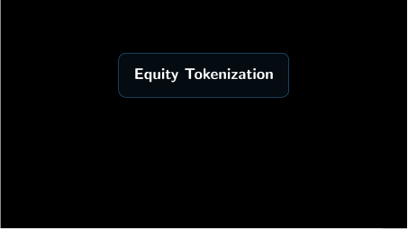

<!-- Backup source: files/equity-tokenization-primer.pdf, page 1. Original footer number removed. -->

---
layout: primer-backup
title: "Backup: Five Questions — Overview"
hideInToc: true
---
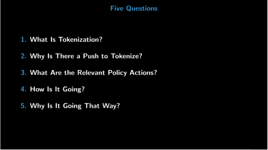

<!-- Backup source: files/equity-tokenization-primer.pdf, page 2. Original footer number removed. -->

---
layout: primer-backup
title: "Backup: Five Questions — What Is Tokenization?"
hideInToc: true
---
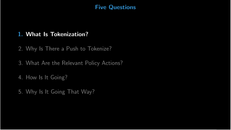

<!-- Backup source: files/equity-tokenization-primer.pdf, page 3. Original footer number removed. -->

---
layout: primer-backup
title: "Backup: What Is Tokenization?"
hideInToc: true
---
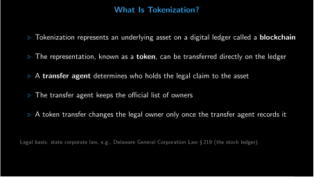

<!-- Backup source: files/equity-tokenization-primer.pdf, page 4. Original footer number removed. -->

---
layout: primer-backup
title: "Backup: Three Tokenization Models"
hideInToc: true
---
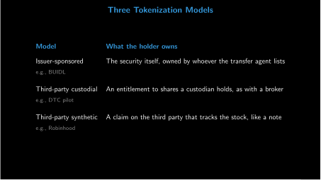

<!-- Backup source: files/equity-tokenization-primer.pdf, page 5. Original footer number removed. -->

---
layout: primer-backup
title: "Backup: Synthetic Tokens: Price Exposure, Not Ownership"
hideInToc: true
---
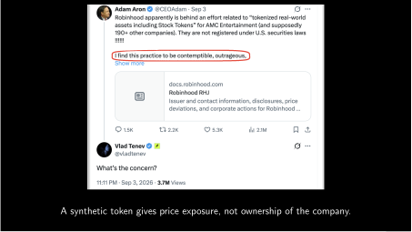

<!-- Backup source: files/equity-tokenization-primer.pdf, page 6. Original footer number removed. -->

---
layout: primer-backup
title: "Backup: Five Questions — Why Tokenize?"
hideInToc: true
---
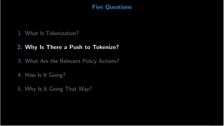

<!-- Backup source: files/equity-tokenization-primer.pdf, page 7. Original footer number removed. -->

---
layout: primer-backup
title: "Backup: Who Owns Your Shares Today?"
hideInToc: true
---
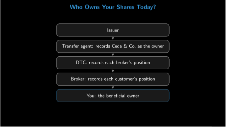

<!-- Backup source: files/equity-tokenization-primer.pdf, page 8. Original footer number removed. -->

---
layout: primer-backup
title: "Backup: Purported Benefits of Tokenization"
hideInToc: true
---
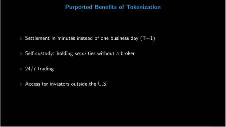

<!-- Backup source: files/equity-tokenization-primer.pdf, page 9. Original footer number removed. -->

---
layout: primer-backup
title: "Backup: Five Questions — Policy Actions"
hideInToc: true
---
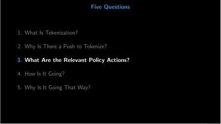

<!-- Backup source: files/equity-tokenization-primer.pdf, page 10. Original footer number removed. -->

---
layout: primer-backup
title: "Backup: Proposed Transfer Agent Rules (September 2026)"
hideInToc: true
---
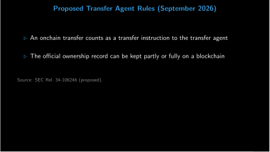

<!-- Backup source: files/equity-tokenization-primer.pdf, page 11. Original footer number removed. -->

---
layout: primer-backup
title: "Backup: SEC Innovation Exemption (September 2026)"
hideInToc: true
---
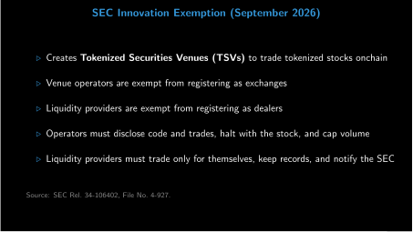

<!-- Backup source: files/equity-tokenization-primer.pdf, page 12. Original footer number removed. -->

---
layout: primer-backup
title: "Backup: Issuers Can Say No"
hideInToc: true
---
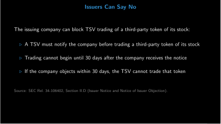

<!-- Backup source: files/equity-tokenization-primer.pdf, page 13. Original footer number removed. -->

---
layout: primer-backup
title: "Backup: Issuers Object to Third-party Tokenization"
hideInToc: true
---
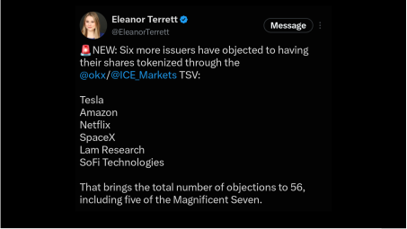

<!-- Backup source: files/equity-tokenization-primer.pdf, page 14. Original footer number removed. -->

---
layout: primer-backup
title: "Backup: Five Questions — How Is It Going?"
hideInToc: true
---
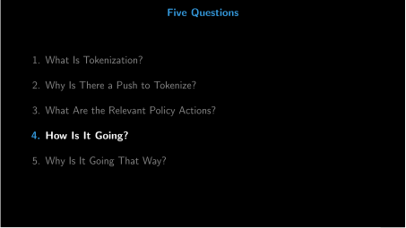

<!-- Backup source: files/equity-tokenization-primer.pdf, page 15. Original footer number removed. -->

---
layout: primer-backup
title: "Backup: Equity Tokenization Remains Trivial in Scale"
hideInToc: true
---
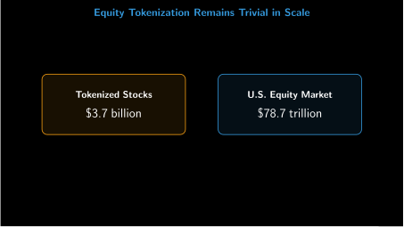

<!-- Backup source: files/equity-tokenization-primer.pdf, page 16. Original footer number removed. -->

---
layout: primer-backup
title: "Backup: Nearly All Tokenized Stocks Are Synthetic"
hideInToc: true
---
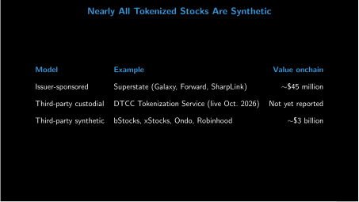

<!-- Backup source: files/equity-tokenization-primer.pdf, page 17. Original footer number removed. -->

---
layout: primer-backup
title: "Backup: Tokenized Stocks Barely Trade"
hideInToc: true
---
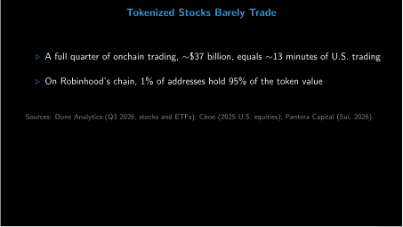

<!-- Backup source: files/equity-tokenization-primer.pdf, page 18. Original footer number removed. -->

---
layout: primer-backup
title: "Backup: Weekend AMC Token Price Spike"
hideInToc: true
---
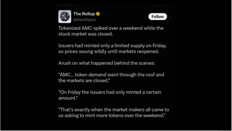

<!-- Backup source: files/equity-tokenization-primer.pdf, page 19. Original footer number removed. -->

---
layout: primer-backup
title: "Backup: Five Questions — Why Is It Going That Way?"
hideInToc: true
---
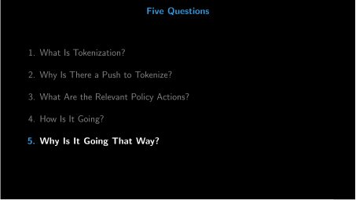

<!-- Backup source: files/equity-tokenization-primer.pdf, page 20. Original footer number removed. -->

---
layout: primer-backup
title: "Backup: Why Hold Securities Onchain?"
hideInToc: true
---
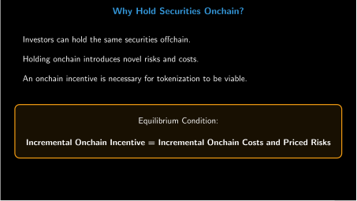

<!-- Backup source: files/equity-tokenization-primer.pdf, page 21. Original footer number removed. -->

---
layout: primer-backup
title: "Backup: Incremental Onchain Incentive"
hideInToc: true
---
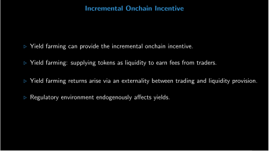

<!-- Backup source: files/equity-tokenization-primer.pdf, page 22. Original footer number removed. -->

---
layout: primer-backup
title: "Backup: The Role of Regulation"
hideInToc: true
---
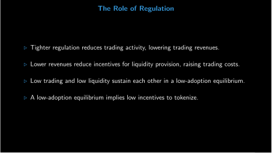

<!-- Backup source: files/equity-tokenization-primer.pdf, page 23. Original footer number removed. -->

---
layout: primer-backup
title: "Backup: Regulation in Practice: Volume Caps"
hideInToc: true
---
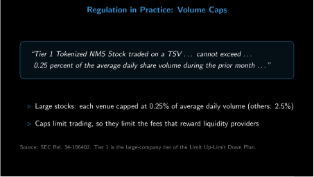

<!-- Backup source: files/equity-tokenization-primer.pdf, page 24. Original footer number removed. -->

---
layout: primer-backup
title: "Backup: Stringent Regulation Undermines Tokenization"
hideInToc: true
---
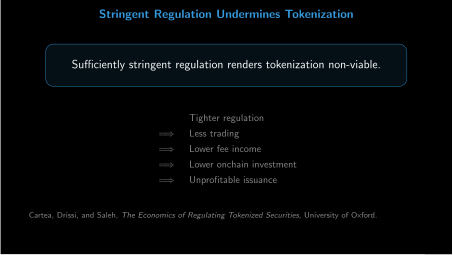

<!-- Backup source: files/equity-tokenization-primer.pdf, page 25. Original footer number removed. -->
